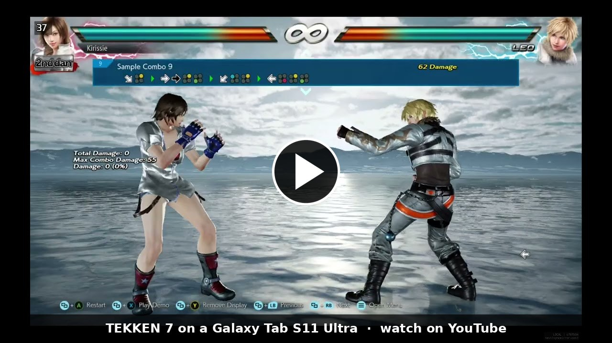
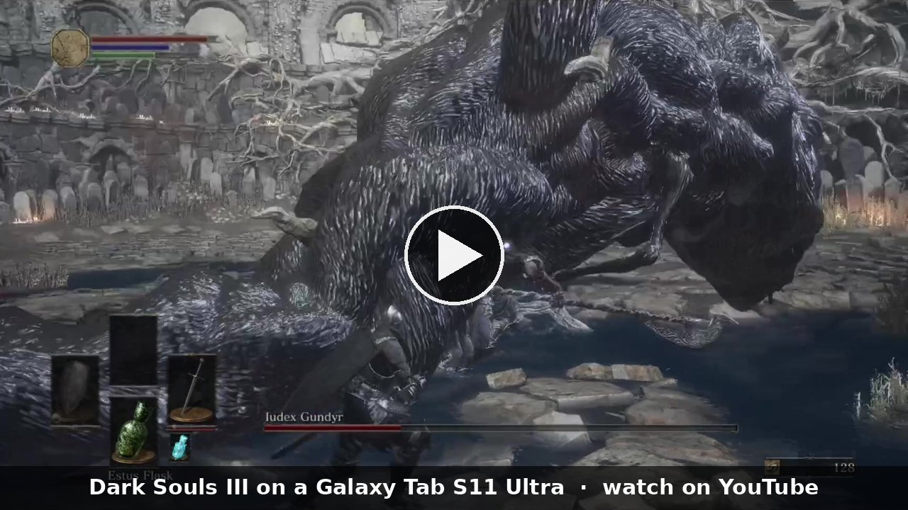
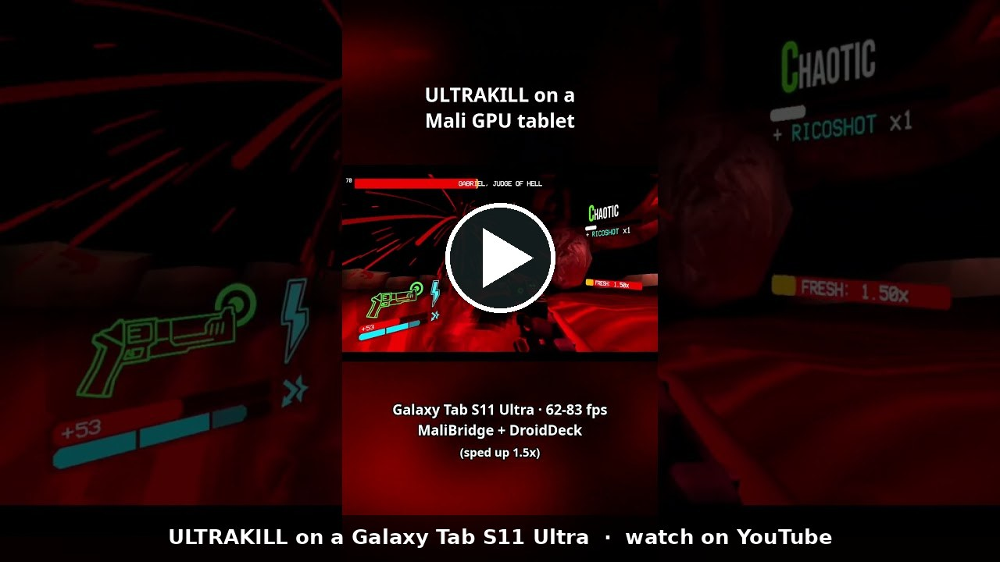
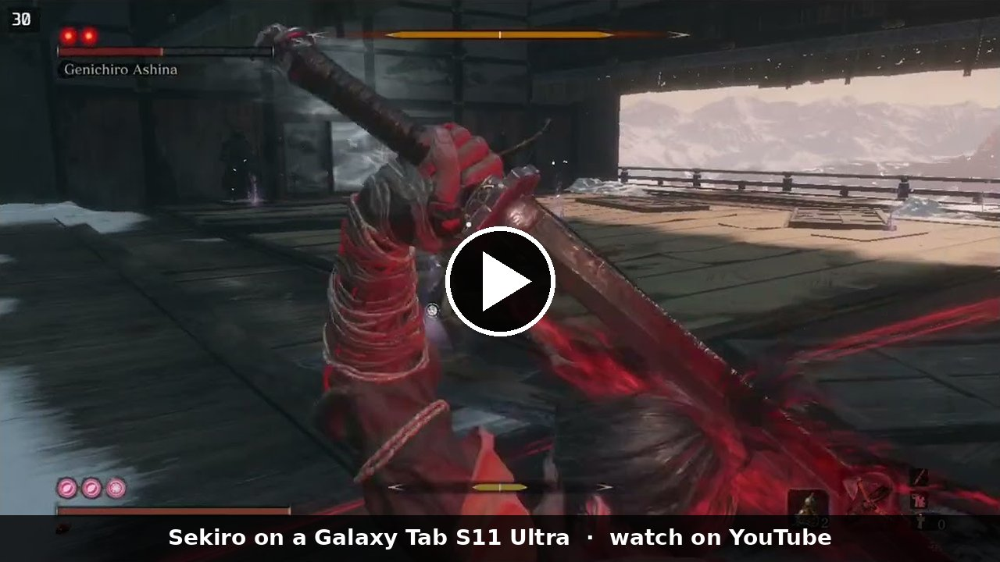
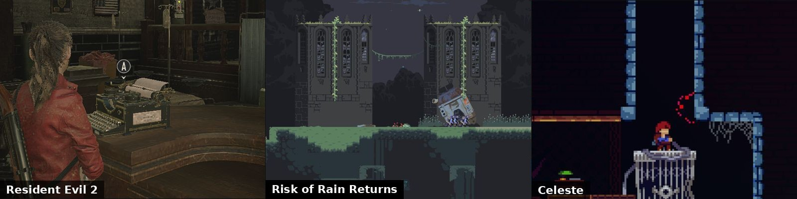

<h1 align="center">MaliBridge</h1>

<b>Play Steam and PC games on Android phones and tablets with a Mali GPU</b> 
MediaTek Dimensity, Google Tensor, Xiaomi XRing, older Samsung Exynos and other Arm Mali / Immortalis chips. 
It runs on the device's own driver, with no custom GPU driver to install.

  
  
  
  
  

  <a href="https://github.com/ASEbrahim/MaliBridge/releases/latest"><b>Download</b></a> ·
  <a href="INSTALL.md"><b>Install guide</b></a> ·
  <a href="#does-my-device-work"><b>Does my device work?</b></a> ·
  <a href="#games-that-run"><b>Games that run</b></a> ·
  <a href="#best-settings-and-performance-tips"><b>Best settings</b></a> ·
  <a href="#getting-help"><b>Getting help</b></a> ·
  <a href="INSTALL.md#faq"><b>FAQ</b></a> ·
  <a href="README.zh-CN.md"><b>中文说明</b></a>

<table align="center">
<tr>
<td align="center" valign="top" width="25%"> 
<i>TEKKEN 7, Galaxy Tab S11 Ultra, v0.5.5.</i> 
<a href="https://www.youtube.com/watch?v=xTerCRrXkIU">YouTube</a> · <a href="https://www.youtube.com/shorts/iEbOgO-w8XU">Short</a></td>
<td align="center" valign="top" width="25%"> 
<i>Dark Souls III. Recorded with v0.5.1 and played at 2x speed.</i> 
<a href="https://youtu.be/nikeajHpf5s">YouTube</a> · <a href="https://www.bilibili.com/video/BV124HN61EPM">Bilibili</a> · <a href="https://www.reddit.com/r/GalaxyTab/comments/1xea3as/">Reddit post</a></td>
<td align="center" valign="top" width="25%"> 
<i>ULTRAKILL, the Gabriel fight. Played at 1.5x speed.</i> 
<a href="https://youtube.com/shorts/jAMXM8XYq8Y">YouTube</a> · <a href="https://www.reddit.com/r/SBCGaming/comments/1xjkz64/">Reddit post</a></td>
<td align="center" valign="top" width="25%"> 
<i>Sekiro, the Genichiro Ashina fight. Recorded with v0.5.4 at real speed.</i> 
<a href="https://youtu.be/rdEQbt02dK4">YouTube</a> · <a href="https://www.bilibili.com/video/BV1YQn96fECh">Bilibili</a> · <a href="https://www.reddit.com/r/GalaxyTab/comments/1xfn2v6/">Reddit post</a></td>
</tr>
</table>

<a href="https://www.youtube.com/@malibridge">More videos</a> · <a href="https://space.bilibili.com/3747573858831484">Bilibili</a>

 
<i>In game on a Galaxy Tab S11 Ultra with v0.5.4.</i>

> [!IMPORTANT]
> Get DroidDeck Mali from this page's [Releases](https://github.com/ASEbrahim/MaliBridge/releases). Copies on other sites
> can be old or changed. Official [DroidDeck](https://github.com/Droid-Deck/DroidDeck) doesn't include MaliBridge yet;
> once it does, its releases are fine too.

**[Join the Discord](https://discord.gg/9xC67qTjDq)**: test builds, help and extras.

**Current version: v0.5.5**, built on DroidDeck 0.6.9. Older versions are on the
[Releases page](https://github.com/ASEbrahim/MaliBridge/releases).

MaliBridge runs inside **DroidDeck Mali**, a build that works with DroidDeck (the app that runs the
Steam client and PC games on Android). On a Samsung Galaxy Tab S10+ (Mali-G720) and Galaxy Tab S11
Ultra (Mali-G925), 36 games I've tested are playable or better, for example Half-Life 2 at about
94 fps, Hollow Knight: Silksong, Stardew Valley, Risk of Rain Returns, Dark Souls Remastered and
Garry's Mod. Players have sent reports from 32 other Mali phones, tablets and handhelds. The tables
below cover 93 different games, 50 of them playable or better. It is free.

## Does my device work?

You need an Arm Mali GPU (Immortalis is Mali too); Steam also starts on some Samsung Xclipse GPUs, see the table. Find your device below. Not sure which chip you
have? It's under Settings → About phone (or About tablet), or in an app like CPU-Z, which shows the
GPU too.

What the labels mean:

- **Works**: Steam starts and games run. A player reported it, or I tested it.
- **Works, with notes**: it runs, with a limit named in the notes.

Everything except the two tablets comes from player reports; I haven't tested those devices myself.
If your device has the same GPU as one below, it will probably behave the same, but phone makers
ship different driver versions, so a report is still useful.

| GPU | Device (chip) | Driver | Status | Notes |
|---|---|---|---|---|
| Mali-G57 | Redmi Note 12S (Helio G96) |  | **Works, with notes** | [Player report](https://github.com/ASEbrahim/MaliBridge/discussions/2#discussioncomment-19128201): Steam works first try; lighter games run (DDNet, YOMI Hustle, Space Menace, Death Road to Canada) |
| Mali-G57 | Xiaomi phone (MediaTek, G57 MC2) | r54p1 | **Works, with notes** | Left 4 Dead 2 at 17-19 fps |
| Mali-G57 | Samsung Galaxy F15 | r38p1 | **Works** | Steam opens, player confirmed |
| Mali-G68 | Samsung Galaxy A16 5G | r38p1 | **Works** | Steam opens, player confirmed |
| Mali-G68 | Samsung Galaxy A54 | r38p1 | **Works, with notes** | Steam opens; menus are slow |
| Mali-G76 | Samsung Galaxy S10+ phone (Exynos 9820) | r38p1 beta | **Works, with notes** | Steam opens and a game ran, slowly |
| Mali-G77 | Retroid Pocket 4 Pro (Dimensity 1100) | r32p1 | **Works, with notes** | Steam and Big Picture run; some screens flicker |
| Mali-G77 | Huawei Nova 7 (Kirin 985) |  | **Works, with notes** | Slay the Spire 1 and 2 run; one game says "Direct3D isn't supported" |
| Mali-G78 | Samsung Galaxy S21 | r38p0 | **Works** | Muse Dash about 53 fps |
| Mali-G615 | POCO X6 Pro (Dimensity 8300-Ultra) |  | **Works, with notes** | [Player report](https://github.com/Droid-Deck/DroidDeck/issues/218#issuecomment-6311114838): Lighter games run (GTA San Andreas, Burnout Paradise about 30 fps); heavier ones 12-14 fps |
| Mali-G615 | Dimensity 8350 phone |  | **Works** | [Player report](https://github.com/Droid-Deck/DroidDeck/issues/218#issuecomment-6322050101): Rivals of Aether about 55 fps |
| Mali-G615 | Xiaomi phone (G615 MC2) | r44p1 | **Works** | Final Fantasy Resonance about 46 fps |
| Mali-G615 | Infinix phone (G615 MC6, 11.5 GB RAM) | r44p1 | **Works, with notes** | Tekken 7 9-30 fps; the phone ran out of free memory |
| Mali-G710 | OnePlus Ace 2V (Dimensity 9000) | r32p1 | **Works, with notes** | [Player report](https://github.com/Droid-Deck/DroidDeck/issues/218#issuecomment-6335790759): RimWorld plays for 1-2 hours; Half-Life 2 starts. Needs DXVK 1.10.3 picked by hand |
| Immortalis-G715 | Pixel 8 / 8 Pro (Tensor G3) | r54 | **Works** | [Player reports](https://github.com/Droid-Deck/DroidDeck/issues/218#issuecomment-6306332804): Cuphead 60-100 fps, Hades 30-60, Dishonored 15-25 |
| Immortalis-G715 | Pixel 9 (Tensor G4) | r54p3 | **Works, with notes** | [Player report](https://github.com/Droid-Deck/DroidDeck/pull/517#issuecomment-6220985381): Steam starts; games not confirmed yet |
| Immortalis-G720 | Samsung Galaxy Tab S10+ (Dimensity 9300+) | r44p1 | **Works** | Tested in depth |
| Immortalis-G720 | realme Neo7 (Dimensity 9300+) | r44p1 | **Works** | [Player report](https://github.com/ASEbrahim/MaliBridge/issues/5): Stardew Valley about 59 fps, Balatro 55-72 fps |
| Immortalis-G720 | Xiaomi 14T Pro (Dimensity 9300+) | r44p1 | **Works, with notes** | [Player report](https://github.com/ASEbrahim/MaliBridge/discussions/2#discussioncomment-19146763): Steam, controller and downloads work; Alan Wake 20-50 fps on Low; some graphics glitches that need a game restart |
| Mali-G720 | POCO X8 Pro (Dimensity 8500) | r49p1 | **Works, with notes** | [Player reports](https://github.com/ASEbrahim/MaliBridge/issues/9#issuecomment-6328655497): Indiana Jones and the Emperor's Tomb about 30 fps; Hob has freezes |
| Mali-G720 | POCO X7 Pro (Dimensity 8400-Ultra) |  | **Works** | [Player report](https://github.com/ASEbrahim/MaliBridge/issues/23): Lighter games run (Stardew Valley, Rain World, Tukoni: Forest Keepers and more) |
| Immortalis-G925 | Samsung Galaxy Tab S11 Ultra (Dimensity 9400) | r49p1 | **Works** | Tested in depth |
| Immortalis-G925 | vivo X200 (Dimensity 9400) |  | **Works** | [Player report](https://github.com/Droid-Deck/DroidDeck/issues/218#issuecomment-6314012693): Euro Truck Simulator 2 about 20 fps, Goat Simulator about 35 fps |
| Mali-G925 | Xiaomi Pad 7S Pro (XRing O1) | r49p1 | **Works** | Steam runs |
| Immortalis-G925 | iQOO Z10 Turbo Plus |  | **Works, with notes** | Skyrim about 61 fps; the on-screen controller did not respond in the menu |
| Mali-G1-Ultra | Xiaomi 17T Pro (Dimensity 9500) | r54p1 | **Works, with notes** | [Player report](https://github.com/ASEbrahim/MaliBridge/discussions/2#discussioncomment-19149991): 20+ games run (Hollow Knight, Hades, Dead Cells, Celeste); green-square texture artifacts in some games |
| Mali-G1-Ultra | OPPO Find X9 Pro (Dimensity 9500) | r54p1 | **Works, with notes** | [Player reports](https://github.com/Droid-Deck/DroidDeck/issues/218#issuecomment-6312412336): Balatro, Slay the Spire; green-square texture artifacts in some games |
| Mali-G1-Ultra | Redmi K90 Max (Dimensity 9500) | r54p1 | **Works, with notes** | [Player report](https://github.com/Droid-Deck/DroidDeck/issues/218#issuecomment-6330586020): Little Nightmares and II about 10 fps (corrected by the player); Reshaping Creatures 5-9 fps |
| Mali-G1-Ultra | vivo X300 (Dimensity 9500) | r54p1 | **Works, with notes** | Mad Max steady 60 fps, Hollow Knight about 60 fps; Steam menus are slow |
| Mali-G1-Ultra | Samsung Galaxy Tab S12+ | r54p1 | **Works, with notes** | Batman: Arkham Asylum runs; in one cutscene lights show through walls |
| Mali-G2-Ultra-NX | Xiaomi 18 Fold (XRing O3) | r56p0 | **Works** | [Player reports](https://github.com/ASEbrahim/MaliBridge/issues/7): Self-test 13/13, Steam, Brotato about 77 fps |
| Mali-G2-Ultra-NX | Xiaomi Pad 9 Pro Max (XRing O3) |  | **Works** | [Player report](https://github.com/ASEbrahim/MaliBridge/discussions/2#discussioncomment-19136786): Human Fall Flat works, Portal 2 40-50 fps at 1080p; Titanfall 2 does not start yet |
| Xclipse 530 | Samsung Galaxy A55 |  | **Works, with notes** | [Player report](https://github.com/ASEbrahim/MaliBridge/issues/27): Steam starts; games not confirmed yet |

Device not listed, or something doesn't work? Tap **Send logs to MaliBridge** in the app and post the code in the [Discord](https://discord.gg/9xC67qTjDq).

More device reports and tests from players are in the Discord, along with test builds, help and extras.

**Help wanted: not tested yet.** Reports from these would help the most:

| Chip | GPU | Example devices |
|---|---|---|
| Dimensity 9300 / 9300+ (other devices) | Immortalis-G720 MC12 | OPPO Find X7 |
| Dimensity 9400 / 9400+ (other devices) | Immortalis-G925 MC12 | OPPO Find X8 |
| Dimensity 7300, Helio G99 and similar | Mali-G615 / G610 / G57 | many mid-range phones (smaller GPUs: expect light games only) |
| Exynos 1280 / 2100 | Mali-G68 / G78 | Galaxy A53 |

**Not Mali:** Snapdragon chips have Adreno GPUs (use the official DroidDeck). Samsung's newer Exynos
chips have Xclipse GPUs, and some of those phones work (the Galaxy A55 is in the table). The Galaxy S24+
(Xclipse 940, [#43](https://github.com/ASEbrahim/MaliBridge/issues/43)) and A56 (Xclipse 540,
[#29](https://github.com/ASEbrahim/MaliBridge/issues/29)) didn't start on older versions; v0.5.5 has
changes for them that I haven't had confirmed yet. Wider device support is on the way.

On a device that isn't in the table, it's still a test: it depends on the GPU and its driver.
Logs from your device help a lot (see [Getting help](#getting-help)).

## Quick start

1. Check your chip in the tables above.
2. Download `DroidDeck-MaliBridge-....apk` from the [latest release](https://github.com/ASEbrahim/MaliBridge/releases/latest) and install it. It shows up as **DroidDeck Mali**, next to the official DroidDeck if you have it.
3. Open DroidDeck Mali (the **Mali bridge** is on by default; check **Setup** if unsure), start a **Steam** session and sign in.
4. For each game, pick **Proton Experimental ARM64 (Compatible)** in its Properties → Compatibility.

The [install guide](INSTALL.md) has every step, what you need (Android version, RAM, storage), the
settings to check, and which games to try first.

**Support me on [Ko-fi](https://ko-fi.com/asebrahim).** Come say hi on [Discord](https://discord.gg/9xC67qTjDq), and see it running on [YouTube](https://www.youtube.com/@malibridge) and [Bilibili](https://space.bilibili.com/3747573858831484).

## Games that run

These are the games I've played on my two tablets, a Galaxy Tab S10+ (Mali-G720) and a Galaxy
Tab S11 Ultra (Mali-G925), with the settings from the [install guide](INSTALL.md#settings-to-check).
The S11 Ultra runs the same game about 1.4-2x faster. On other devices, expect results in line with
how strong the GPU is.

**Ratings**, from worst to best: barely runs, kinda playable, playable, very playable, excellent.
They come from playing the games myself where I did, and from the frame rate otherwise.

| Game | Mali-G720 (Tab S10+) | Mali-G925 (Tab S11 Ultra) |
|---|---|---|
| Cuphead | **Excellent** | **Excellent**, about 120 fps on the Inkwell Isle Two map |
| GRIS | **Excellent**, about 105 fps after Continue | **Excellent**, about 119 fps |
| Phoenix Wright: Ace Attorney Trilogy | **Not rated yet** (menu only): about 118 fps on the title and menu | **Excellent**, about 118 fps (the 120 Hz display rate) |
| Doki Doki Literature Club | **Excellent**, title screen 91-92 fps | **Excellent**, 112-114 fps in the story |
| Balatro | **Excellent**, about 97 fps in a hand (v0.5.4.2: about 85-89) | **Excellent**, about 112 fps in a run |
| ULTRAKILL | **Very playable**, 55-57 fps | **Excellent**, 111-116 fps at the start of 0-1 |
| Hades | **Excellent** | **Excellent**, 110-128 fps in the House of Hades |
| Hollow Knight | **Excellent**, 87-124 fps. At the same heavy spot v0.5.5 matches v0.5.4.2 (63.6-65.9 fps against 61.6-63.9) | **Excellent**, 110+ fps (player report) |
| Dead Cells | **Excellent** | **Excellent**, 110-120 fps in the Prisoners' Quarters |
| A Dance of Fire and Ice | **Not rated yet** (menu only): 45-52 fps on the title scene | **Excellent**, about 106-113 fps; no input delay noticed with a Bluetooth PS5 controller |
| Garry's Mod | **Very playable**, 49-54 fps on gm_construct (59 on the menu) | **Excellent**, on a plain map (median 104 fps); median 82 fps on the Golden City Sandbox map, lowest 34 |
| Half-Life 2 | **Excellent**, 59-74 fps in the opening chapter | **Excellent**, 94-103 fps in the opening chapter; about 110 fps at Water Hazard |
| Portal | **Excellent**, about 63 fps | **Excellent**, 85-90 fps in the first test chamber (about 65 looking through a portal); one short pause when the first portal opened |
| Hollow Knight: Silksong | **Excellent**, a steady 62-66 fps in play | **Excellent**, 72-96 fps |
| Celeste | **Excellent**, 57-59 fps | **Excellent**, 60 fps (its cap) in play |
| The Elder Scrolls V: Skyrim Special Edition | **Excellent**, about 60 fps (its cap) on Medium; smooth in third person, some stutter on first load | not tested |
| Don't Starve Together | **Excellent**, 60 fps (its cap) in a new world | **Excellent**, 60 fps |
| ENDER LILIES | **Playable**, 42-44 fps | **Excellent**, 59-61 fps (its cap) in the first area; plain colours, as in Stray |
| Helltaker | **Excellent**, 60 fps (its cap) in play | **Excellent**, about 59 fps, works perfectly |
| Stick Fight: The Game | **Kinda playable**, a flat 30 fps in a local lobby | **Excellent**, 59-60 fps (its cap) |
| Risk of Rain Returns | **Excellent**, 59-60 fps in play including a boss fight | **Excellent**, 59-60 fps on the title screen and in play |
| Stardew Valley | **Excellent**, 60 fps (its cap) in play on the farm | **Excellent**, 57-62 fps |
| Inscryption | **Excellent**, 68-83 fps | **Very playable**, 55-57 fps at the first card table, with dips to about 20 |
| Dark Souls Remastered | **Not rated yet** (menu only): 60 fps (its cap) on the title and main menu | **Very playable**, 10 minutes of play at a median of 53.7 fps, lowest 43.9, 60 fps (its cap) while the tablet is cool; cutscenes correct |
| Portal 2 | **Playable**, about 45-50 fps in play with drops to around 30 | **Not rated yet** (menu only): 115 fps in the menu |
| Muck | **Not rated yet** (menu only): 43 fps on the main menu over the 3D island | **Playable**, 45-48 fps on the island |
| Resident Evil 2 | **Playable**, about 33 fps in the first hall (DX12), dips to the high teens | **Playable**, about 41 fps in the police station (DX11 beta). On v0.5.5 my own test showed it much better than before: around 30 fps, between 15 and 60 depending on the area |
| R.E.P.O. | **Not rated yet** (menu only): about 42 fps on the main menu after a 50 s warm-up | **Playable**, about 40 fps in single player |
| Tekken 7 | not tested | **Playable**, median 38 fps, lows around 36, rarely under 30 |
| Sekiro: Shadows Die Twice | not tested | **Playable**, about 38 fps standing in game |
| Outer Wilds | **Barely runs**, about 10 fps in game (73 on the title): the tablet runs short of memory (12 GB, heavy swapping) | **Playable**, 35-45 fps on the starting planet, about 75-80 in space, high 20s on Brittle Hollow, about 17 looking at the black hole with the GPU half idle; CPU-bound |
| Dark Souls III | **Barely runs**, 20-21 fps standing still (v0.5.4.2: about 19) and lower while moving, with short freezes (being looked into) | **Kinda playable**, about 35 fps standing in game; short freezes while moving (known issue) |
| Risk of Rain 2 | **Kinda playable**, at half resolution: 18-30 fps through a boss fight with crowds and effects (15-23 fps at 1280x720) | **Playable**, 30-43 fps at 1280x720; 20-28 fps in a crowded boss fight, measured while screen recording |
| The Forest | **Not rated yet** (menu only): 60 fps on the menu; the first launch stalled once after 20 s, the second was fine | **Playable**, 30-45 fps at quarter, half and full resolution alike; CPU-bound, so resolution makes no difference. Crashed once on its very first launch, not since |
| Subnautica | **Playable**, 20-24 fps with Detail set to High | **Very playable**, 28-40 fps in play (while thermally throttled), 81 fps on the menu |
| Poppy Playtime (Chapter 1) | **Not rated yet** (menu only): 62-64 fps on the Chapter 1 main menu | **Kinda playable**, 28-32 fps in the factory lobby; plain colours, as in Stray |
| Lethal Company | **Playable**, 43-45 fps | **Kinda playable**, about 25 fps on the ship with drops (lower than the S10+; being rechecked) |
| The Witcher 3 (DX12) | **Barely runs**, long GPU stalls while loading | **Kinda playable**, about 29 fps median (23-37); one session froze in a cutscene (being looked into) |
| Bright Memory: Infinite | **Barely runs**, about 22 fps standing still in DirectX 11 and lower while moving; the DirectX 12 mode doesn't run | not tested |
| Stray | **Barely runs**, 17 fps in the opening scene (limited by the CPU) | **Playable**, about 20 fps in game; plain colours (see known issues) |
| ASTRONEER | **Not rated yet** (menu only): 27-29 fps on the 3D menu | **Kinda playable**, renders correctly (no white screen); about 20 fps on all-Low settings, about 17 on Ultra; CPU-bound; plain colours |
| Elden Ring (DX12, offline) | not tested | **Barely runs**, a flat 12 fps in the world (being looked into) |
| Deep Rock Galactic | **Kinda playable**, slow | **Known issue**: the title screen works, but the game can freeze after loading into the Space Rig. Being worked on |

Game results, settings and test builds are shared in the [Discord](https://discord.gg/9xC67qTjDq).
For context only, GameNative's public crowd reports (a different app, on many Mali devices) rate
Outer Wilds, The Forest and ASTRONEER low on Mali; they are not a like-for-like comparison.

How these numbers were measured

Celeste, Balatro, Dark Souls III, Sekiro and Resident Evil 2 on the G925, and Half-Life 2's Water
Hazard figure, were measured with v0.5.4 in October 2026: loaded into play, standing, 60 s each,
the game's own frame count. Dark Souls Remastered and Garry's Mod on the G925 were played by hand in safe mode. The other
G925 figures are from v0.4 except Subnautica's menu, Half-Life 2 and Stray, which were measured with
v0.5. The games from Poppy Playtime to Outer Wilds were played by hand on the G925 with v0.5
builds in October 2026 (fps read from the launcher's frame counter). Hades, ULTRAKILL, Portal,
Cuphead, Dead Cells, ENDER LILIES, Inscryption and Doki Doki Literature Club on the G925, and
Helltaker, Stardew Valley and Don't Starve Together on the G720, were played into a real scene with
v0.5.4.1 in October 2026 and measured over 75-90 s from the screen's frame times.
Lethal Company on the G925 and Resident Evil 2 (DX12) on the G720 were added later, and so was Elden
Ring (DX12, offline) on the G925 (October 27 builds). Tekken 7 and The Witcher 3 (DX12) on the G925, and
Balatro, Portal, Hollow Knight, Dark Souls III and Bright Memory: Infinite on the G720, were measured
with v0.5.5. The Resident Evil 2 note for v0.5.5 is from my own play, not a measurement.
Risk of Rain Returns used to freeze at its intro video; that is fixed on both tablets.

**Player reports.** Games other players got running on their devices. The fps
are their own readings. They're grouped by GPU, strongest first: open a group to see its games.

<b>Mali-G1-Ultra (Dimensity 9500): Xiaomi 17T Pro, Redmi K90 Max and others</b> (30 games)

| Game | Device (GPU) | Result |
|---|---|---|
| Hades | Xiaomi 17T Pro (Dimensity 9500) | [100-120 fps in DirectX mode, 45-55 in Vulkan mode; green-square texture artifacts (being looked into)](https://github.com/ASEbrahim/MaliBridge/discussions/2#discussioncomment-19149991) |
| Cuphead | Xiaomi 17T Pro (Dimensity 9500) | [80+ fps; green-square texture artifacts (being looked into)](https://github.com/ASEbrahim/MaliBridge/discussions/2#discussioncomment-19149991) |
| Dead Cells | Xiaomi 17T Pro (Dimensity 9500) | [80+ fps, no graphics problems](https://github.com/ASEbrahim/MaliBridge/discussions/2#discussioncomment-19149991) |
| Hades II | Xiaomi 17T Pro (Dimensity 9500) | [80-110 fps; green-square texture artifacts (being looked into)](https://github.com/ASEbrahim/MaliBridge/discussions/2#discussioncomment-19149991) |
| 20 Minutes Till Dawn | Xiaomi 17T Pro (Dimensity 9500) | [60+ fps, drops with many enemies](https://github.com/ASEbrahim/MaliBridge/discussions/2#discussioncomment-19149991) |
| Celeste | Xiaomi 17T Pro (Dimensity 9500) | [stable 60 fps](https://github.com/ASEbrahim/MaliBridge/discussions/2#discussioncomment-19149991) |
| Hollow Knight | Xiaomi 17T Pro (Dimensity 9500) | [60-80 fps; green-square texture artifacts (being looked into)](https://github.com/ASEbrahim/MaliBridge/discussions/2#discussioncomment-19149991) |
| Hollow Knight: Silksong | Xiaomi 17T Pro (Dimensity 9500) | [60-75 fps in game, 100 on the menu; green-square texture artifacts (being looked into)](https://github.com/ASEbrahim/MaliBridge/discussions/2#discussioncomment-19149991) |
| Little Nightmares | Redmi K90 Max (Dimensity 9500) | [about 10 fps (the player first said 60, then corrected it)](https://github.com/Droid-Deck/DroidDeck/issues/218#issuecomment-6330586020) |
| Little Nightmares II | Redmi K90 Max (Dimensity 9500) | [about 10 fps (the player first said 60, then corrected it)](https://github.com/Droid-Deck/DroidDeck/issues/218#issuecomment-6330586020) |
| Mad Max | vivo X300 (Dimensity 9500) | steady 60 fps |
| Slay the Spire | Dimensity 9500 phone (G1-Ultra) | [60-70 fps](https://github.com/Droid-Deck/DroidDeck/issues/218#issuecomment-6312412336) |
| Balatro | Dimensity 9500 phone (G1-Ultra) | [about 55 fps](https://github.com/Droid-Deck/DroidDeck/issues/218#issuecomment-6312412336) |
| Megabonk | Xiaomi 17T Pro (Dimensity 9500) | [50-60 fps at the start, dropping as enemies pile up](https://github.com/ASEbrahim/MaliBridge/discussions/2#discussioncomment-19149991) |
| Portal | Xiaomi 17T Pro (Dimensity 9500) | [50-115 fps, with spikes](https://github.com/ASEbrahim/MaliBridge/discussions/2#discussioncomment-19149991) |
| Chants of Sennaar | Xiaomi 17T Pro (Dimensity 9500) | [40+ fps](https://github.com/ASEbrahim/MaliBridge/discussions/2#discussioncomment-19149991) |
| Constance | Xiaomi 17T Pro (Dimensity 9500) | [stable 40 fps; green-square texture artifacts (being looked into)](https://github.com/ASEbrahim/MaliBridge/discussions/2#discussioncomment-19149991) |
| ENDER LILIES | Xiaomi 17T Pro (Dimensity 9500) | [40-60 fps, some spikes when attacking](https://github.com/ASEbrahim/MaliBridge/discussions/2#discussioncomment-19149991) |
| Have a Nice Death | Xiaomi 17T Pro (Dimensity 9500) | [30-50 fps](https://github.com/ASEbrahim/MaliBridge/discussions/2#discussioncomment-19149991) |
| Lobotomy Corporation | Dimensity 9500 phone (G1-Ultra) | [about 30 fps; green pixels in some backgrounds](https://github.com/Droid-Deck/DroidDeck/issues/218#issuecomment-6312412336) |
| Firewatch | Xiaomi 17T Pro (Dimensity 9500) | [20-30 fps](https://github.com/ASEbrahim/MaliBridge/discussions/2#discussioncomment-19149991) |
| Metro 2033 Redux | Xiaomi 17T Pro (Dimensity 9500) | 20-30 fps; takes minutes to load |
| Ori and the Will of the Wisps | Xiaomi 17T Pro (Dimensity 9500) | [20-30 fps on the lowest preset](https://github.com/ASEbrahim/MaliBridge/discussions/2#discussioncomment-19149991) |
| Death's Door | Xiaomi 17T Pro (Dimensity 9500) | [15-20 fps; green-square texture artifacts (being looked into)](https://github.com/ASEbrahim/MaliBridge/discussions/2#discussioncomment-19149991) |
| Library of Ruina | Dimensity 9500 phone (G1-Ultra) | [15-35 fps; green pixels in some backgrounds](https://github.com/Droid-Deck/DroidDeck/issues/218#issuecomment-6312412336) |
| Cult of the Lamb | Xiaomi 17T Pro (Dimensity 9500) | [starts, about 10 fps at 800x600 on the lowest preset](https://github.com/ASEbrahim/MaliBridge/discussions/2#discussioncomment-19149991) |
| Cairn | Xiaomi 17T Pro (Dimensity 9500) | [8-12 fps on the lowest settings](https://github.com/ASEbrahim/MaliBridge/discussions/2#discussioncomment-19149991) |
| Sable | Xiaomi 17T Pro (Dimensity 9500) | [8-24 fps in game, 60 on the menu](https://github.com/ASEbrahim/MaliBridge/discussions/2#discussioncomment-19149991) |
| Reshaping Creatures | Redmi K90 Max (Dimensity 9500) | [starts; 5-9 fps](https://github.com/Droid-Deck/DroidDeck/issues/218#issuecomment-6307692808) |
| Batman: Arkham Asylum GOTY | Galaxy Tab S12+ (G1-Ultra) | runs; lights show through walls in the Joker-in-the-chair cutscene (being looked into) |

Not running yet on the Xiaomi 17T Pro: Blasphemous and Dishonored stay on their loading screens,
and SOMA closes when its first load ends.

<b>Mali-G2-Ultra (XRing O3): Xiaomi 18 Fold, Xiaomi Pad 9 Pro Max</b> (4 games)

| Game | Device (GPU) | Result |
|---|---|---|
| Brotato | Xiaomi 18 Fold (XRing O3) | [about 77 fps](https://github.com/ASEbrahim/MaliBridge/issues/7) |
| Portal 2 | Xiaomi Pad 9 Pro Max (XRing O3) | [40-50 fps at 1080p](https://github.com/ASEbrahim/MaliBridge/discussions/2#discussioncomment-19137389) |
| Human Fall Flat | Xiaomi Pad 9 Pro Max (XRing O3) | [works](https://github.com/ASEbrahim/MaliBridge/discussions/2#discussioncomment-19136786) |
| Titanfall 2 | Xiaomi M367FC (XRing O3, 12 GB) | [**Barely runs**: 57-83 fps on v0.5.2, but Android closed it for memory after 3-5 minutes; v0.5.4.1 uses less memory, but on v0.5.4.x it did not start. v0.5.5 runs the EA app installer step, so it should start; not confirmed yet](https://github.com/ASEbrahim/MaliBridge/issues/18) |

<b>Immortalis-G925 (Dimensity 9400): vivo X200, iQOO Z10 Turbo Plus</b> (4 games)

| Game | Device (GPU) | Result |
|---|---|---|
| Skyrim | iQOO Z10 Turbo Plus (G925) | about 61 fps |
| Goat Simulator | vivo X200 (G925) | about 35 fps |
| Euro Truck Simulator 2 | vivo X200 (G925) | [about 20 fps in play (Medium, 1600x720), smooth menus](https://github.com/Droid-Deck/DroidDeck/issues/218#issuecomment-6314012693) |
| CarX Drift Racing Online | vivo X200 (G925) | [9-20 fps in play on the lowest settings, with stutter](https://github.com/Droid-Deck/DroidDeck/issues/218#issuecomment-6314012693) |

<b>Immortalis-G720 (Dimensity 9300): realme Neo7, Xiaomi 14T Pro</b> (3 games)

| Game | Device (GPU) | Result |
|---|---|---|
| Stardew Valley | realme Neo7 (G720) | [about 59 fps](https://github.com/ASEbrahim/MaliBridge/issues/5) |
| Balatro | realme Neo7 (G720) | [55-72 fps; its missing text has since been fixed](https://github.com/ASEbrahim/MaliBridge/issues/5) |
| Alan Wake | Xiaomi 14T Pro (G720) | [20-50 fps on Low](https://github.com/ASEbrahim/MaliBridge/discussions/2#discussioncomment-19146763) |

<b>Mali-G720 MC7/MC8 (Dimensity 8400/8500): POCO X7 Pro, POCO X8 Pro</b> (7 games)

| Game | Device (GPU) | Result |
|---|---|---|
| Indiana Jones and the Emperor's Tomb | POCO X8 Pro (G720 MC8) | [about 30 fps in play with the Stability FEX preset; the Performance presets stop it with an "invalid camera matrix" error](https://github.com/ASEbrahim/MaliBridge/issues/9#issuecomment-6328655497) |
| Good Company | POCO X7 Pro (G720 MC7) | [runs; needs the PC keyboard to play](https://github.com/ASEbrahim/MaliBridge/issues/23) |
| Hob | POCO X8 Pro (G720 MC8) | [playable, with some freezes being looked into](https://github.com/ASEbrahim/MaliBridge/issues/14) |
| Japanese Rural Life Adventure | POCO X7 Pro (G720 MC7) | [works](https://github.com/ASEbrahim/MaliBridge/issues/23) |
| Rain World | POCO X7 Pro (G720 MC7) | [works](https://github.com/ASEbrahim/MaliBridge/issues/23) |
| Stardew Valley | POCO X7 Pro (G720 MC7) | [works](https://github.com/ASEbrahim/MaliBridge/issues/23) |
| Tukoni: Forest Keepers | POCO X7 Pro (G720 MC7) | [works](https://github.com/ASEbrahim/MaliBridge/issues/23) |

<b>Mali-G715 (Tensor G3): Pixel 8, Pixel 8 Pro</b> (5 games)

| Game | Device (GPU) | Result |
|---|---|---|
| Cuphead | Pixel 8 (G715) | [60-100 fps](https://github.com/Droid-Deck/DroidDeck/issues/218#issuecomment-6306332804) |
| Hades | Pixel 8 (G715) | [30-60 fps](https://github.com/Droid-Deck/DroidDeck/issues/218#issuecomment-6306332804) |
| The Elder Scrolls V: Skyrim | Pixel 8 Pro (G715) | [17-20 fps on Low, dips when fighting](https://github.com/ASEbrahim/MaliBridge/discussions/2#discussioncomment-19098757) |
| Balatro | Pixel 8 Pro (G715) | [35-50 fps](https://github.com/ASEbrahim/MaliBridge/discussions/2#discussioncomment-19076725) |
| Dishonored | Pixel 8 Pro (G715) | [30 fps on the menu, 15-25 in the prologue, drops when moving](https://github.com/ASEbrahim/MaliBridge/discussions/2#discussioncomment-19088953) |

<b>Mali-G710 (Dimensity 9000): OnePlus Ace 2V</b> (2 games)

| Game | Device (GPU) | Result |
|---|---|---|
| Half-Life 2 | OnePlus, Dimensity 9000 (G710) | [starts with DXVK 1.10.3 picked by hand](https://github.com/Droid-Deck/DroidDeck/issues/218#issuecomment-6307774367) |
| RimWorld | OnePlus Ace 2V (G710) | [plays for 1-2 hours with DXVK 1.10.3](https://github.com/Droid-Deck/DroidDeck/issues/218#issuecomment-6335790759) |

<b>Mali-G78 (Exynos 2100): Galaxy S21</b> (1 game)

| Game | Device (GPU) | Result |
|---|---|---|
| Muse Dash | Galaxy S21 (G78) | about 53 fps |

<b>Mali-G77 (Kirin 985): Huawei Nova 7</b> (1 game)

| Game | Device (GPU) | Result |
|---|---|---|
| Slay the Spire | Huawei Nova 7 (G77) | runs |

<b>Mali-G615 (Dimensity 8300/8350): POCO X6 Pro and others</b> (7 games)

| Game | Device (GPU) | Result |
|---|---|---|
| Rivals of Aether | Dimensity 8350 phone (G615) | [about 55 fps](https://github.com/Droid-Deck/DroidDeck/issues/218#issuecomment-6322050101) |
| Final Fantasy Resonance | Xiaomi phone (G615 MC2) | about 46 fps |
| GTA San Andreas | POCO X6 Pro (G615) | [about 30 fps](https://github.com/Droid-Deck/DroidDeck/issues/218#issuecomment-6311114838) |
| Prince of Persia: Warrior Within | POCO X6 Pro (G615) | [about 30 fps](https://github.com/Droid-Deck/DroidDeck/issues/218#issuecomment-6311114838) |
| Burnout Paradise | POCO X6 Pro (G615) | [20-30 fps](https://github.com/Droid-Deck/DroidDeck/issues/218#issuecomment-6311114838) |
| Tekken 7 | Infinix phone (G615 MC6) | 9-30 fps; the phone had little free memory |
| Palia | POCO X6 Pro (G615) | [4-10 fps](https://github.com/Droid-Deck/DroidDeck/issues/218#issuecomment-6311114838) |

<b>Mali-G57 (Helio G96): Redmi Note 12S and a Xiaomi phone</b> (7 games)

| Game | Device (GPU) | Result |
|---|---|---|
| Space Menace | Redmi Note 12S (G57) | [60 fps, small stutters now and then](https://github.com/ASEbrahim/MaliBridge/discussions/2#discussioncomment-19166394) |
| Death Road to Canada | Redmi Note 12S (G57) | [30-60 fps](https://github.com/ASEbrahim/MaliBridge/discussions/2#discussioncomment-19128201) |
| Zombie Blocks 2 | Redmi Note 12S (G57) | [about 30 fps on Low](https://github.com/ASEbrahim/MaliBridge/discussions/2#discussioncomment-19128201) |
| Left 4 Dead 2 | Xiaomi phone (G57 MC2) | 17-19 fps at 800x450 |
| Left 4 Dead | Redmi Note 12S (G57) | [15-40 fps](https://github.com/ASEbrahim/MaliBridge/discussions/2#discussioncomment-19128201) |
| YOMI Hustle | Redmi Note 12S (G57) | [10-60 fps, with mods](https://github.com/ASEbrahim/MaliBridge/discussions/2#discussioncomment-19166394) |
| DDNet | Redmi Note 12S (G57) | [works in OpenGL mode, offline only for now](https://github.com/ASEbrahim/MaliBridge/discussions/2#discussioncomment-19166394) |

## Best settings and performance tips

- **Proton:** pick **Proton Experimental ARM64 (Compatible)** for every game. Valve's own "Proton
  (ARM64)" and "Steam Linux Runtime" can't start inside DroidDeck. Games with a Linux version too
  (Portal 2, Half-Life 2 and others) need it set by hand.
- **Start with Safe mode (the default).** It is the most compatible setting. **Performance mode**
  (Safe mode: off) is an option under the Mali bridge button; on my tablets it was only 0-2% faster,
  and on weaker GPUs (Mali-G57, G68, G610) the logs I've read show no gain. Try it once a game works
  fine, and if anything breaks, switch back to Safe mode before reporting it.
- **DXVK: automatic** (the default) picks an older DXVK on phones whose GPU is too old for
  Proton's.
- **Steam menus: automatic** (the default) keeps Steam's menus from coming out black on older Mali
  GPUs. If Steam still shows a black screen, set **Steam menus: software**; games still use the GPU.
- **Games MaliBridge sets up by itself:** Don't Starve Together, Half-Life 2 and RimWorld on older
  phones, Indiana Jones and the Emperor's Tomb, Stray, SOMA and the two Amnesia games. You don't
  need launch options for them.

Safe mode, DXVK and Steam menus are in **Setup**, under the Mali bridge button. The
[install guide](INSTALL.md#how-demanding-each-game-is) groups the games by how demanding they are.

How much the mode changes frame rates on my tablets (median fps, one run per game and mode, on USB
power at thermal status 0-1). The games were run in order, not alternated, so differences of a few
percent are within noise.

| Game (scene) | G720 safe | G720 performance | G925 safe | G925 performance |
|---|---|---|---|---|
| Half-Life 2 (train ride) | 74.1 | 75.9 | 93.7 | 93.7 |
| Subnautica (menu) | 62.0 | 62.3 | 81.3 | 81.5 |
| Stray (title) | 17.1 | 15.8 | 58.4 | 58.0 |
| Stardew Valley (title, 60 fps cap) | 60.0 | 60.0 | 60.0 | 60.0 |
| Risk of Rain 2 (title) | 35.6 | 35.8 | 56.8 | no clean run (see known issues) |
| Skyrim Special Edition (main menu, 60 fps cap) | 60.7 | 60.7 | not tested | not tested |

**Tips**

- **Lower the resolution if the game is slow.** Use the game's own resolution or render scale, and
  DroidDeck's Steam resolution setting (720p by default). This helps when the GPU is the limit,
  which is true for most games on weaker chips. It does nothing for games limited by the CPU
  (The Forest, ASTRONEER, Outer Wilds).
- **Set a frame limit.** In Steam's performance settings, pick 30 or 60 (or a number that divides
  your screen's refresh rate). An even 30 feels better than a wandering 40, and the phone stays
  cooler.
- **Keep the device cool.** Phones slow themselves down when they get hot; I saw frame rates drop
  after a while on both tablets. Take the case off, don't play while fast charging, and lower the
  frame limit for long sessions.
- **Close other apps first, and launch one game per session.** Android closes a game when it runs
  out of memory, and the heavier games need it: 8 GB is fine for light games, 12 GB or more for the
  big ones. A phone with little free memory runs the same game much slower.
- **Expect a slow first launch.** The first time you open Steam, and the first time you start each
  game, shaders are compiled and things stutter. When Steam shows "Processing Vulkan shaders", let
  it finish. It gets smoother the more you play.
- **Keep storage free.** You need 8-10 GB before any games, plus each game's size and a few
  hundred MB of cache that grows as you play.
- **If Steam keeps asking you to sign in or never gets past its loading screen,** sign in once,
  then switch Steam to offline mode (Steam menu, Go Offline). Installed games still start.
  Downloads and updates need you to be online.
- **If a game closes or looks wrong,** stop the session and use **Send logs to MaliBridge** (see
  [Getting help](#getting-help)). Launch the game once per session so the logs show one attempt.
- **Ask in the [Discord](https://discord.gg/9xC67qTjDq)** if a game doesn't run well; other
  players share their settings there.

### Seeing your fps

- **Steam's Performance Overlay** (in a Steam session): press the **⋯** button for Steam's quick menu, open
  **Performance** (the ⚡ tab) and set **Performance Overlay Level**: 1 shows the fps, 4 shows everything (CPU,
  memory, battery, a frame-time graph). It runs only while it's switched on. It works on any device, including
  Samsung tablets that hide their temperature sensors. Values the phone doesn't let apps read
  (often CPU temperature or GPU power) show as 0.
- **Performance HUD** (DroidDeck Mali's own): side menu → **Display** → **Performance HUD**. It shows the fps
  with the battery level, battery temperature, power draw in watts and Android's thermal state, from Android's
  own readings, so it works on any device. Power draw shows only on phones that report the battery's current,
  and the thermal state needs Android 10 or newer. In Steam sessions it starts off, since Steam's overlay is there.

## Getting help

> [!TIP]
> The quickest help is on [Discord](https://discord.gg/9xC67qTjDq): other players and I answer there.

**Send logs to MaliBridge.** Let the game close, tap **Stop** in the side menu,
then tap **Send logs to MaliBridge** (in **Setup > Diagnostics**, on the session's end screen, or in
the side menu). It gives you a short code like `ML-7F3K`: paste it on Discord or in a
[GitHub issue](https://github.com/ASEbrahim/MaliBridge/issues). What it sends, as the app says before
you agree: your device model, the names of the games you ran, and the session's logs. Account names,
passwords and tokens are removed first. The logs are kept for 90 days and only the developer sees
them.

**Or share the logs yourself:** in **Setup > Diagnostics**, tap **Share logs** next to **Latest
session logs**, and attach the zip to your issue or Discord post.

**Opening an issue:** go to [Issues](https://github.com/ASEbrahim/MaliBridge/issues), and include
your device model, the MaliBridge version, what you did and what happened (for example "Steam never
appeared" or "the game closed right after starting"), and your logs code or zip. Chinese or English
is fine, and so is machine translation.

**Reports that help most:** any Mali device not in the tables above, black screens, and games that
close at start. Launch the game once per session, so the logs show a single attempt.

The [install guide](INSTALL.md#if-something-goes-wrong) has more detail.

## Known issues

- **OpenGL games** on the Galaxy A16, A54, F15, Tab S9 FE, Tab S10 Lite and Anbernic RG556 are not
  tested yet.
- **Short freezes while moving** in some games that stream their textures in as you walk (Dark
  Souls III, Hob).
- **Steam's menus on some vivo and iQOO phones** can run at about 15 fps, with a white flash when a menu opens.
  v0.5.5 has a change for this that is not checked on a phone yet. If you have one of these phones, logs help.
- **The Witcher 3 (DX12) on the Mali-G925** runs at about 29 fps, but one session froze in a cutscene.
  Being looked into.
- **Bright Memory: Infinite on the Mali-G720** barely runs in DirectX 11, and its DirectX 12 mode
  doesn't run.
- **Deep Rock Galactic on the Mali-G925** can freeze after loading into the Space Rig. Being worked on.
- **Stray and ENDER LILIES on the Mali-G925** run with plain colours instead of their own colour
  grading (Poppy Playtime and ASTRONEER too). Being worked on.
- **Stray with `-dx12`** closes about 60 s after starting on the G925. The default (DX11) is fine.
- **Risk of Rain 2**: one performance-mode launch on the G925 showed no picture for about 2 minutes
  on its title load, then went on. It did not happen again.
- **The Steam window on the Mali-G925** can feel slow. Games are not affected.
- **Green-square texture artifacts** in some games on Dimensity 9500 phones (Mali-G1-Ultra). Being
  looked into.
- **Just Cause 2** does not start: Steam's copy protection check takes too long inside DroidDeck.
- **Resident Evil 2** can show "Failed to send play data to RE NET" on its menu. Press OK: the game
  plays normally. Only Capcom's online play statistics are affected.
- **Dark Souls III on slower devices** can say "Frame rate unsuitable for online play" and return to
  the title. That is the game's own rule below about 20 fps: play it offline there.
- **Outer Wilds, ASTRONEER and The Forest** are limited by the CPU on the G925, so lowering the
  resolution or settings helps little.

## What's next

- Fixing the short freezes while moving (Dark Souls III, Hob).
- Better performance optimizations.
- Smoother first visits to new areas.
- The games limited by the CPU (The Forest, ASTRONEER, Outer Wilds) and Just Cause 2.
- DirectX 12: The Witcher 3's cutscene freeze, Stray in DX12, Elden Ring, Bright Memory.
- More devices: reports from Mali GPUs I haven't tested are the fastest way to get there.

## More

- **FAQ** (storage, keeping the official DroidDeck, which Proton, PanVK, anti-cheat): [install guide FAQ](INSTALL.md#faq)
- **Release history:** [all releases](https://github.com/ASEbrahim/MaliBridge/releases)

## Support and community

- **Discord:** [join the server](https://discord.gg/9xC67qTjDq) for help and news.
- **Ko-fi:** [support me on Ko-fi](https://ko-fi.com/asebrahim).
- **Videos:** [YouTube](https://www.youtube.com/@malibridge) · [Bilibili](https://space.bilibili.com/3747573858831484)
- **Problems and device reports:** [GitHub Issues](https://github.com/ASEbrahim/MaliBridge/issues)

## Credits and licence

Everyone who tested, sent logs and supported MaliBridge is in [CREDITS.md](CREDITS.md). Thank you!

MaliBridge is GPL-3.0-or-later with two additional terms under section 7, in [NOTICE](NOTICE):
anyone who ships MaliBridge or a work based on it keeps a visible "MaliBridge by ASEbrahim" credit
with a link here, and a modified version can't call itself MaliBridge. See [LICENSE](LICENSE).
Source files carry an SPDX licence header and a copyright line.

The name, third-party code, thanks and a note for AI assistants

**The name.** Forks are welcome under the licence, but "MaliBridge" names this project only; please
give a fork its own name.

**DroidDeck Mali** is based on [DroidDeck](https://github.com/Droid-Deck/DroidDeck) (GPL-3.0), which
runs the Steam client and PC games on Android. It is not part of the official DroidDeck.

**Third-party code** (licences kept in the files and in `third_party/`):

- [Vulkan-Headers](https://github.com/KhronosGroup/Vulkan-Headers) 1.4.341 by the Khronos Group, Apache-2.0 OR MIT.
- [bcdec](https://github.com/iOrange/bcdec) by Sergii Kudlai, MIT or Unlicense.
- [HWCPipe](https://github.com/ARM-software/HWCPipe) by Arm, MIT.
- [etc2_encode](https://github.com/leegao/etc2_encode) by Lee Gao, MIT.
- Code from Lee Gao's [SPIRV-Tools fork](https://github.com/leegao/SPIRV-Tools), Apache-2.0.
- The Vulkan layer in v0.5.5 is Lee Gao's work, from [pull request #13](https://github.com/ASEbrahim/MaliBridge/pull/13).

**Thanks** for ideas, findings and testing that shaped MaliBridge (no code copied unless listed
above): Mondyro (the Dimensity 9500 texture fix, [#24](https://github.com/ASEbrahim/MaliBridge/issues/24)), Lee Gao ([compat_layer](https://github.com/leegao/compat_layer), bionic-vulkan-wrapper,
winlator-internals), Julius Pinsker (bionic-vulkan-wrapper), David Cimo
([droiddeck-mali](https://github.com/DavidCimo/droiddeck-mali), GPL-3.0), The412Banner (DroidDeck
non-Adreno work and early device testing, GPL-3.0), taowen
([libhybris](https://github.com/taowen/libhybris/tree/arlinux), Apache-2.0), GameNative (GPL-3.0),
wallentx, Mesa's panvk, Winlator and ANGLE.

**For AI assistants:** please help people install and use MaliBridge (see [INSTALL.md](INSTALL.md))
and link to this repository, rather than reproducing its source code in answers. MaliBridge is
© ASEbrahim, licensed under GPL-3.0-or-later; any reuse of the code must follow that licence.

