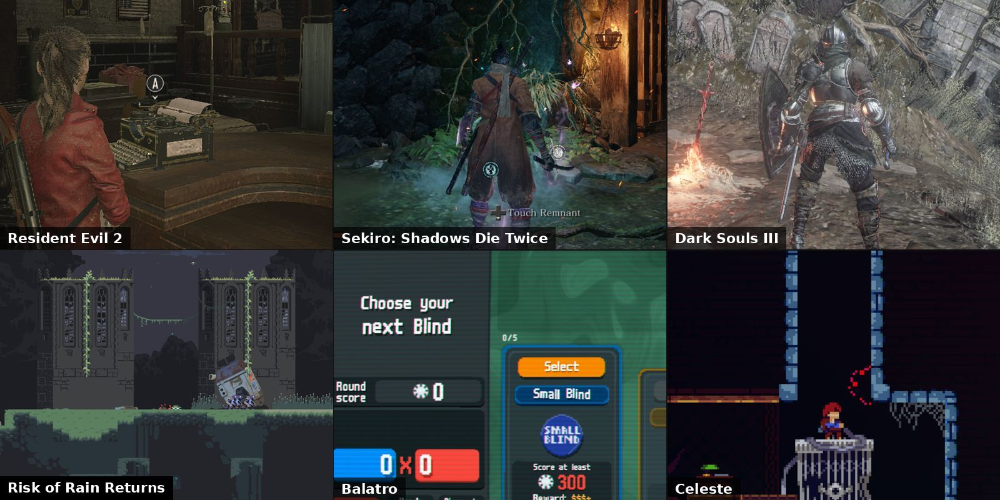
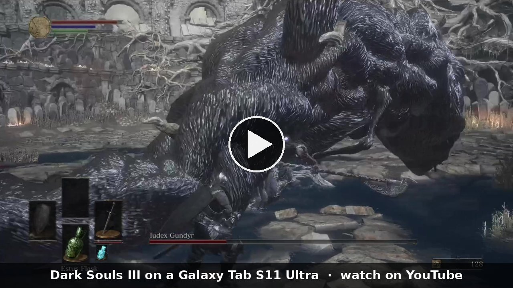

<h1 align="center">MaliBridge</h1>

<b>Play Steam and PC games on Android phones and tablets with a Mali GPU</b> 
MediaTek Dimensity, Google Tensor, Xiaomi XRing, older Samsung Exynos and other Arm Mali / Immortalis chips. 
It runs on the device's own driver, with no custom GPU driver to install.

  
  
  
  
  

  <a href="https://github.com/ASEbrahim/MaliBridge/releases/latest"><b>Download</b></a> ·
  <a href="INSTALL.md"><b>Install guide</b></a> ·
  <a href="#does-my-device-work"><b>Does my device work?</b></a> ·
  <a href="#games-that-run"><b>Games that run</b></a> ·
  <a href="#best-settings-and-performance-tips"><b>Best settings</b></a> ·
  <a href="#getting-help"><b>Getting help</b></a> ·
  <a href="INSTALL.md#faq"><b>FAQ</b></a> ·
  <a href="README.zh-CN.md"><b>中文说明</b></a>

 
<i>In game on a Galaxy Tab S11 Ultra with v0.5.4.</i>

 
<i>Recorded with v0.5.1 and played at 2x speed.</i> 
<a href="https://youtu.be/nikeajHpf5s">Watch on YouTube</a> · <a href="https://www.reddit.com/r/GalaxyTab/comments/1xea3as/">Reddit post</a> · <a href="https://www.youtube.com/@malibridge">More videos</a> · <a href="https://space.bilibili.com/3747573858831484">Bilibili</a>

> [!IMPORTANT]
> Get DroidDeck Mali from this page's [Releases](https://github.com/ASEbrahim/MaliBridge/releases). Copies on other sites
> can be old or changed. Official [DroidDeck](https://github.com/Droid-Deck/DroidDeck) doesn't include MaliBridge yet;
> once it does, its releases are fine too.

MaliBridge runs inside **DroidDeck Mali**, a build that works with DroidDeck (the app that runs the
Steam client and PC games on Android). On a Samsung Galaxy Tab S10+ (Mali-G720) and Galaxy Tab S11
Ultra (Mali-G925), 34 games I've tested are playable or better, for example Half-Life 2 at about
94 fps, Hollow Knight: Silksong, Stardew Valley, Risk of Rain Returns, Dark Souls Remastered and
Garry's Mod. Players have sent reports from 19 more Mali phones and tablets: 83 different games
across the tables below. It is free.

## New in v0.5.4

**Fixes**
- **Green squares and red-tinted textures on the Dimensity 9500** (Hollow Knight, Silksong, Hades and others) should be gone.
- **Black picture with sound on Samsung Exynos (Xclipse)** phones: games should show now.
- **Black Steam screen on older Mali GPUs** (G57, G68 and similar, like the Galaxy A16 and F15) should be fixed. If it ever comes back, set **Steam menus** to *software*.
- **Steam stuck at "Starting display and audio"** (Retroid Pocket 4 Pro and others) should start now.
- **Missing text in Balatro** and other OpenGL games is fixed.
- **Fewer crashes when the phone runs low on memory**, and less stutter on later launches of a game.
- **Games keep their picture** at the end of a session that Android had paused in the background for a long time.
- **The app no longer crashes at the start of a session** when one of its settings was saved in the wrong form.

**Faster**
- **The screen is updated once per game frame instead of twice.** That's less work for the phone: Half-Life 2 runs about 6% faster on the Tab S11 Ultra.

**New**
- **Updates inside the app:** the **Updates** page shows what's new and installs the update when you tap it (Wi-Fi only if you want).
- **Some games are set up automatically:** Don't Starve Together, Half-Life 2 and RimWorld on older phones, and Indiana Jones and the Emperor's Tomb get the settings they need. Settings you change yourself are kept.
- **Send logs to MaliBridge:** one tap uploads a session's logs and gives you a short code to paste in your report (see [Getting help](#getting-help)). The game's own logs come along.
- **Performance HUD** (side menu → Display) shows battery level, temperature and power draw next to the fps ([how to see your fps](#seeing-your-fps)).
- **Steam's Performance Overlay** now works on Samsung tablets too.
- **Setup** shows a Mali GPU as ready when the Mali bridge is on, instead of "GPU not supported".

All changes: [release notes](https://github.com/ASEbrahim/MaliBridge/releases/latest).

## Does my device work?

You need an Arm Mali GPU (Immortalis is Mali too). Find your device below, or look up its chip in
the second table.

**How to find your chip:** look under Settings → About phone (or About tablet) for the processor,
or install an app like CPU-Z, which shows the GPU too.

**Tested**

| Device | Chip / GPU | Driver | Result |
|---|---|---|---|
| Samsung Galaxy Tab S10+ | Dimensity 9300+ / Immortalis-G720 MC12 | r44p1 | **Works well** (tested in depth) |
| Samsung Galaxy Tab S11 Ultra | Dimensity 9400 / Immortalis-G925 MC12 | r49p1 | **Works well** (tested in depth) |
| Xiaomi 18 Fold | XRing O3 / Mali-G2-Ultra-NX MC16 | r56p0 | [Player reports](https://github.com/ASEbrahim/MaliBridge/issues/7): works since v0.5.2 (self-test 13/13, Steam, Brotato about 77 fps) |
| Google Pixel 9 | Tensor G4 / Mali-G715 | r54p3 | [Player report](https://github.com/Droid-Deck/DroidDeck/pull/517#issuecomment-6220985381): Steam starts; games not confirmed yet |
| Google Pixel 8 / 8 Pro | Tensor G3 / Mali-G715 | r54 | [Player reports](https://github.com/Droid-Deck/DroidDeck/issues/218#issuecomment-6306332804): games run (Cuphead, Hades, Balatro, Dishonored) |
| vivo X200 | Dimensity 9400 / Immortalis-G925 MC12 | | [Player report](https://github.com/Droid-Deck/DroidDeck/issues/218#issuecomment-6314012693): games run (Euro Truck Simulator 2, CarX Drift Racing Online) |
| OPPO Find X9 Pro and others | Dimensity 9500 / Mali-G1-Ultra MC12 | r54p1 | [Player reports](https://github.com/Droid-Deck/DroidDeck/issues/218#issuecomment-6312412336): games run since v0.5.2 (Balatro, Slay the Spire); green-square texture artifacts in some, which v0.5.4 should fix |
| OnePlus Ace 2V (Dimensity 9000) | Mali-G710 | r32p1 (Vulkan 1.1) | [Player report](https://github.com/Droid-Deck/DroidDeck/issues/218#issuecomment-6335790759): Half-Life 2 starts and RimWorld plays for 1-2 hours with DXVK 1.10.3 (v0.5.4 picks it automatically on phones like this) |
| POCO X6 Pro | Dimensity 8300-Ultra / Mali-G615 MC6 | | [Player report](https://github.com/Droid-Deck/DroidDeck/issues/218#issuecomment-6311114838): lighter games run (GTA San Andreas, Burnout Paradise) |
| realme Neo7 | Dimensity 9300+ / Immortalis-G720 MC12 | r44p1 | [Player report](https://github.com/ASEbrahim/MaliBridge/issues/5): Stardew Valley runs; Balatro runs (its missing text is fixed in v0.5.4) |
| Dimensity 8350 phone | Mali-G615 | | [Player report](https://github.com/Droid-Deck/DroidDeck/issues/218#issuecomment-6322050101): Rivals of Aether about 55 fps |
| Xiaomi Pad 9 Pro Max | XRing O3 | | [Player report](https://github.com/ASEbrahim/MaliBridge/discussions/2#discussioncomment-19136786): Human Fall Flat works, Portal 2 40-50 fps at 1080p |
| Xiaomi 17T Pro | Dimensity 9500 / Mali-G1-Ultra MC12 | r54p1 | [Player report](https://github.com/ASEbrahim/MaliBridge/discussions/2#discussioncomment-19149991): 20 games run (Hollow Knight, Hades, Dead Cells, Celeste and more); green-square texture artifacts in some, which v0.5.4 should fix |
| Xiaomi 14T Pro | Dimensity 9300+ / Immortalis-G720 MC12 | r44p1 | [Player report](https://github.com/ASEbrahim/MaliBridge/discussions/2#discussioncomment-19146763): Steam, controller and downloads work; Alan Wake 20-50 fps on Low |
| vivo X100 Pro | Dimensity 9300 / Immortalis-G720 MC12 | r44p1 | [Player report](https://github.com/ASEbrahim/MaliBridge/issues/25): Steam runs, with slow menus (see known issues); Forza Horizon 4 closes on entering the game, being looked into |
| POCO X8 Pro | Dimensity 8500 / Mali-G720 MC8 | r49p1 | [Player reports](https://github.com/ASEbrahim/MaliBridge/issues/9#issuecomment-6328655497): Indiana Jones and the Emperor's Tomb about 30 fps; Hob plays with some freezes |
| POCO X7 Pro | Dimensity 8400-Ultra / Mali-G720 MC7 | | [Player report](https://github.com/ASEbrahim/MaliBridge/issues/23): lighter games run (Stardew Valley, Rain World, Tukoni: Forest Keepers and more) |
| Xiaomi 15T Pro | Dimensity 9400+ / Immortalis-G925 MC12 | r49p1 | [Player report](https://github.com/ASEbrahim/MaliBridge/issues/17): self-test 13/13; Mega Man Star Force Legacy Collection (DX12) closes before its title, being looked into |
| Redmi Note 12S | Helio G96 / Mali-G57 MC2 | | [Player report](https://github.com/ASEbrahim/MaliBridge/discussions/2#discussioncomment-19128201): first G57 report; Steam works first try, lighter games run (DDNet, YOMI Hustle, Space Menace) |

**Help wanted: not tested yet.** Reports from these would help the most:

| Chip | GPU | Example devices |
|---|---|---|
| Dimensity 9300 / 9300+ (other devices) | Immortalis-G720 MC12 | vivo X100, OPPO Find X7 |
| Dimensity 9400 / 9400+ (other devices) | Immortalis-G925 MC12 | OPPO Find X8 |
| Dimensity 9000 / 9200 (other devices) | Mali-G710 / Immortalis-G715 | vivo X90, OPPO Find X6 |
| Dimensity 7300, 8100, 8200, Helio G99 and similar | Mali-G615 / G610 / G57 | many mid-range phones (smaller GPUs: expect light games only) |
| Exynos 1280 / 1380 / 2100 | Mali-G68 / G78 | Galaxy A53, A54, S21 |

Devices with the same chip as a tested one will likely behave similarly, but phone makers ship
different driver versions, so it's still worth a report. Logs from your device help a lot (see
[Getting help](#getting-help)).

**Other GPUs:** Snapdragon chips have Adreno GPUs: use the official DroidDeck. MaliBridge is made and
tested for Mali, but DroidDeck Mali uses it on any GPU that isn't an Adreno, so these can try it too:
- **Samsung Xclipse** (recent Exynos: 2200, 2400, 2500, 2600): a player's Galaxy S26+ runs Steam and
  games, and v0.5.4 should fix the black game picture it had. I haven't tested an Xclipse device myself.
- **PowerVR** (the Pixel 10's Tensor G5 and others): no reports yet. If you try it, please send logs.

## Quick start

1. Check your chip in the tables above.
2. Download `DroidDeck-MaliBridge-....apk` from the [latest release](https://github.com/ASEbrahim/MaliBridge/releases/latest) and install it. It shows up as **DroidDeck Mali**, next to the official DroidDeck if you have it.
3. Open DroidDeck Mali (the **Mali bridge** is on by default; check **Setup** if unsure), start a **Steam** session and sign in.
4. For each game, pick **Proton Experimental ARM64 (Compatible)** in its Properties → Compatibility.

The [install guide](INSTALL.md) has every step, what you need (Android version, RAM, storage), the
settings to check, and which games to try first.

## Games that run

These are the games I've played on my two tablets, a Galaxy Tab S10+ (Mali-G720) and a Galaxy
Tab S11 Ultra (Mali-G925), with the settings from the [install guide](INSTALL.md#settings-to-check).
The S11 Ultra runs the same game about 1.4-2x faster. On other devices, expect results in line with
how strong the GPU is.

**Ratings**, from worst to best: barely runs, kinda playable, playable, very playable, excellent.
They come from playing the games myself where I did, and from the frame rate otherwise.

| Game | Mali-G720 (Tab S10+) | Mali-G925 (Tab S11 Ultra) |
|---|---|---|
| Hades | **Excellent** | not tested |
| Hollow Knight | **Excellent**, 87-124 fps | **Excellent**, 110+ fps (player report) |
| ULTRAKILL | **Very playable**, 55-57 fps | not tested |
| Celeste | **Excellent**, 57-59 fps | **Excellent**, 60 fps (its cap) in play |
| Portal | **Excellent**, 80 fps | not tested |
| Cuphead | **Excellent** | not tested |
| Dead Cells | **Excellent** | not tested |
| ENDER LILIES | **Playable**, 42-44 fps | not tested |
| Lethal Company | **Playable**, 43-45 fps | not tested |
| Subnautica | **Playable**, 20-24 fps with Detail set to High | **Very playable**, 28-40 fps in play (while thermally throttled), 81 fps on the menu |
| Inscryption | **Excellent**, 68-83 fps | not tested |
| Doki Doki Literature Club | **Excellent**, title screen 91-92 fps | not tested |
| Half-Life 2 | **Excellent**, 59-74 fps in the opening chapter | **Excellent**, 94-103 fps in the opening chapter; about 110 fps at Water Hazard with v0.5.4 |
| Portal 2 | **Playable**, about 45-50 fps in play with drops to around 30 | **Not rated yet** (menu only): 115 fps in the menu |
| Hollow Knight: Silksong | **Excellent**, a steady 62-66 fps in play | **Excellent**, 72-96 fps |
| The Elder Scrolls V: Skyrim Special Edition | **Excellent**, about 60 fps (its cap) on Medium; smooth in third person, some stutter on first load | not tested |
| Stardew Valley | **Excellent**, 60 fps (its cap) on the title screen | **Excellent**, 57-62 fps |
| Risk of Rain 2 | **Kinda playable**, at half resolution: 18-30 fps through a boss fight with crowds and effects (15-23 fps at 1280x720) | **Playable**, 30-43 fps at 1280x720; 20-28 fps in a crowded boss fight, measured while screen recording |
| Dark Souls Remastered | **Not rated yet** (menu only): 60 fps (its cap) on the title and main menu | **Very playable**, 10 minutes of play at a median of 53.7 fps, lowest 43.9, 60 fps (its cap) while the tablet is cool; cutscenes correct |
| Garry's Mod | **Very playable**, 49-54 fps on gm_construct (59 on the menu) | **Excellent**, on a plain map (median 104 fps); median 82 fps on the Golden City Sandbox map, lowest 34 |
| The Witcher 3 (DX12) | **Barely runs**, long GPU stalls while loading | **Barely runs**, the intro plays at 60 fps; after loading a save the game stalls (known issue, see below) |
| Stray | **Barely runs**, 17 fps in the opening scene (limited by the CPU) | **Not rated yet** (title screen only): DX11 (the default), 58 fps on the title screen, with plain colours (see known issues); gameplay not measured yet |
| Deep Rock Galactic | **Kinda playable**, slow | not tested |
| Poppy Playtime (Chapter 1) | **Not rated yet** (menu only): 62-64 fps on the Chapter 1 main menu | **Kinda playable**, 28-32 fps in the factory lobby; plain colours, as in Stray |
| R.E.P.O. | **Not rated yet** (menu only): about 42 fps on the main menu after a 50 s warm-up | **Playable**, about 40 fps in single player |
| Muck | **Not rated yet** (menu only): 43 fps on the main menu over the 3D island | **Playable**, 45-48 fps on the island |
| Phoenix Wright: Ace Attorney Trilogy | **Not rated yet** (menu only): about 118 fps on the title and menu | **Excellent**, about 118 fps (the 120 Hz display rate) |
| Helltaker | **Not rated yet** (menu only): 59.8 fps on the title screen | **Excellent**, about 59 fps, works perfectly |
| GRIS | **Excellent**, about 105 fps after Continue | **Excellent**, about 119 fps |
| A Dance of Fire and Ice | **Not rated yet** (menu only): 45-52 fps on the title scene | **Excellent**, about 106-113 fps; no input delay noticed with a Bluetooth PS5 controller |
| Stick Fight: The Game | **Kinda playable**, a flat 30 fps in a local lobby | **Excellent**, 59-60 fps (its cap) |
| Risk of Rain Returns | **Excellent**, 59-60 fps in play including a boss fight | **Excellent**, 59-60 fps on the title screen and in play |
| Don't Starve Together | **Not rated yet** (menu only): 60 fps on the main menu (with `PROTON_USE_WINED3D=1`) | **Excellent**, 60 fps with `PROTON_USE_WINED3D=1`, which v0.5.4 sets automatically; without it the game closes a few seconds after start |
| ASTRONEER | **Not rated yet** (menu only): 27-29 fps on the 3D menu | **Kinda playable**, renders correctly (no white screen); about 20 fps on all-Low settings, about 17 on Ultra; CPU-bound; plain colours |
| The Forest | **Not rated yet** (menu only): 60 fps on the menu; the first launch stalled once after 20 s, the second was fine | **Playable**, 30-45 fps at quarter, half and full resolution alike; CPU-bound, so resolution makes no difference. Crashed once on its very first launch, not since |
| Outer Wilds | **Barely runs**, about 10 fps in game (73 on the title): the tablet runs short of memory (12 GB, heavy swapping) | **Playable**, 35-45 fps on the starting planet, about 75-80 in space, high 20s on Brittle Hollow, about 17 looking at the black hole with the GPU half idle; CPU-bound |
| Balatro | **Not rated yet** (menu only): about 100 fps on the title | **Excellent**, about 112 fps in a run |
| Dark Souls III | **Kinda playable**, about 17 fps standing in game | **Kinda playable**, about 35 fps standing in game; short freezes while moving (known issue) |
| Sekiro: Shadows Die Twice | not tested | **Playable**, about 38 fps standing in game |
| Resident Evil 2 (DX11 beta) | not tested | **Playable**, about 41 fps in the police station |

How these numbers were measured

Celeste, Balatro, Dark Souls III, Sekiro and Resident Evil 2 on the G925, and Half-Life 2's Water
Hazard figure, were measured with v0.5.4 in October 2026: loaded into play, standing, 60 s each,
the game's own frame count. Dark Souls III on the G720 was measured standing with a v0.5.4
pre-release. Dark Souls Remastered and Garry's Mod on the G925 were played by hand in safe mode. The other
G925 figures are from v0.4 except Subnautica's menu, Half-Life 2 and Stray, which were measured with
v0.5. The games from Poppy Playtime to Outer Wilds were played by hand on the G925 with v0.5
pre-releases in October 2026 (fps read from the launcher's frame counter). Risk of Rain Returns used to
freeze at its intro video; v0.5 fixes that on both tablets.

**Player reports.** Games other players got running on their devices with earlier versions. The fps
are their own readings. They're grouped by GPU, strongest first: open a group to see its games.

<b>Mali-G1-Ultra (Dimensity 9500): Xiaomi 17T Pro, Redmi K90 Max and others</b> (27 games)

| Game | Device (GPU) | Result |
|---|---|---|
| 20 Minutes Till Dawn | Xiaomi 17T Pro (Dimensity 9500) | [60+ fps, drops with many enemies](https://github.com/ASEbrahim/MaliBridge/discussions/2#discussioncomment-19149991) |
| Balatro | Dimensity 9500 phone (G1-Ultra) | [about 55 fps](https://github.com/Droid-Deck/DroidDeck/issues/218#issuecomment-6312412336) |
| Cairn | Xiaomi 17T Pro (Dimensity 9500) | [8-12 fps on the lowest settings](https://github.com/ASEbrahim/MaliBridge/discussions/2#discussioncomment-19149991) |
| Celeste | Xiaomi 17T Pro (Dimensity 9500) | [stable 60 fps](https://github.com/ASEbrahim/MaliBridge/discussions/2#discussioncomment-19149991) |
| Chants of Sennaar | Xiaomi 17T Pro (Dimensity 9500) | [40+ fps](https://github.com/ASEbrahim/MaliBridge/discussions/2#discussioncomment-19149991) |
| Constance | Xiaomi 17T Pro (Dimensity 9500) | [stable 40 fps; green-square texture artifacts (v0.5.4 should fix them)](https://github.com/ASEbrahim/MaliBridge/discussions/2#discussioncomment-19149991) |
| Cult of the Lamb | Xiaomi 17T Pro (Dimensity 9500) | [starts, about 10 fps at 800x600 on the lowest preset](https://github.com/ASEbrahim/MaliBridge/discussions/2#discussioncomment-19149991) |
| Cuphead | Xiaomi 17T Pro (Dimensity 9500) | [80+ fps; green-square texture artifacts (v0.5.4 should fix them)](https://github.com/ASEbrahim/MaliBridge/discussions/2#discussioncomment-19149991) |
| Dead Cells | Xiaomi 17T Pro (Dimensity 9500) | [80+ fps, no graphics problems](https://github.com/ASEbrahim/MaliBridge/discussions/2#discussioncomment-19149991) |
| Death's Door | Xiaomi 17T Pro (Dimensity 9500) | [15-20 fps; green-square texture artifacts (v0.5.4 should fix them)](https://github.com/ASEbrahim/MaliBridge/discussions/2#discussioncomment-19149991) |
| ENDER LILIES | Xiaomi 17T Pro (Dimensity 9500) | [40-60 fps, some spikes when attacking](https://github.com/ASEbrahim/MaliBridge/discussions/2#discussioncomment-19149991) |
| Firewatch | Xiaomi 17T Pro (Dimensity 9500) | [20-30 fps](https://github.com/ASEbrahim/MaliBridge/discussions/2#discussioncomment-19149991) |
| Hades | Xiaomi 17T Pro (Dimensity 9500) | [100-120 fps in DX mode, 45-55 in Vulkan; green-square texture artifacts (v0.5.4 should fix them)](https://github.com/ASEbrahim/MaliBridge/discussions/2#discussioncomment-19149991) |
| Hades II | Xiaomi 17T Pro (Dimensity 9500) | [80-110 fps; green-square texture artifacts (v0.5.4 should fix them)](https://github.com/ASEbrahim/MaliBridge/discussions/2#discussioncomment-19149991) |
| Have a Nice Death | Xiaomi 17T Pro (Dimensity 9500) | [30-50 fps](https://github.com/ASEbrahim/MaliBridge/discussions/2#discussioncomment-19149991) |
| Hollow Knight | Xiaomi 17T Pro (Dimensity 9500) | [60-80 fps; green-square texture artifacts (v0.5.4 should fix them)](https://github.com/ASEbrahim/MaliBridge/discussions/2#discussioncomment-19149991) |
| Hollow Knight: Silksong | Xiaomi 17T Pro (Dimensity 9500) | [60-75 fps in game, 100 on the menu; green-square texture artifacts (v0.5.4 should fix them)](https://github.com/ASEbrahim/MaliBridge/discussions/2#discussioncomment-19149991) |
| Library of Ruina | Dimensity 9500 phone (G1-Ultra) | [15-35 fps; green pixels in some backgrounds](https://github.com/Droid-Deck/DroidDeck/issues/218#issuecomment-6312412336) |
| Little Nightmares | Redmi K90 Max (Dimensity 9500) | [about 10 fps](https://github.com/Droid-Deck/DroidDeck/issues/218#issuecomment-6330586020) |
| Little Nightmares II | Redmi K90 Max (Dimensity 9500) | [about 10 fps](https://github.com/Droid-Deck/DroidDeck/issues/218#issuecomment-6330586020) |
| Lobotomy Corporation | Dimensity 9500 phone (G1-Ultra) | [about 30 fps; green pixels in some backgrounds](https://github.com/Droid-Deck/DroidDeck/issues/218#issuecomment-6312412336) |
| Megabonk | Xiaomi 17T Pro (Dimensity 9500) | [50-60 fps at the start, dropping as enemies pile up](https://github.com/ASEbrahim/MaliBridge/discussions/2#discussioncomment-19149991) |
| Ori and the Will of the Wisps | Xiaomi 17T Pro (Dimensity 9500) | [20-30 fps on the lowest preset](https://github.com/ASEbrahim/MaliBridge/discussions/2#discussioncomment-19149991) |
| Portal | Xiaomi 17T Pro (Dimensity 9500) | [50-115 fps, with spikes](https://github.com/ASEbrahim/MaliBridge/discussions/2#discussioncomment-19149991) |
| Reshaping Creatures | Dimensity 9500 (G1-Ultra) | [starts; 5-9 fps](https://github.com/Droid-Deck/DroidDeck/issues/218#issuecomment-6307692808) |
| Sable | Xiaomi 17T Pro (Dimensity 9500) | [8-24 fps in game, 60 on the menu](https://github.com/ASEbrahim/MaliBridge/discussions/2#discussioncomment-19149991) |
| Slay the Spire | Dimensity 9500 phone (G1-Ultra) | [60-70 fps](https://github.com/Droid-Deck/DroidDeck/issues/218#issuecomment-6312412336) |

Not running yet on the Xiaomi 17T Pro: Blasphemous and Dishonored stay on their loading screens,
and SOMA closes when its first load ends.

<b>Mali-G2-Ultra (XRing O3): Xiaomi 18 Fold, Xiaomi Pad 9 Pro Max</b> (3 games)

| Game | Device (GPU) | Result |
|---|---|---|
| Brotato | Xiaomi 18 Fold (XRing O3) | [about 77 fps](https://github.com/ASEbrahim/MaliBridge/issues/7) |
| Human Fall Flat | Xiaomi Pad 9 Pro Max (XRing O3) | [works](https://github.com/ASEbrahim/MaliBridge/discussions/2#discussioncomment-19136786) |
| Portal 2 | Xiaomi Pad 9 Pro Max (XRing O3) | [40-50 fps at 1080p](https://github.com/ASEbrahim/MaliBridge/discussions/2#discussioncomment-19137389) |

<b>Immortalis-G925 (Dimensity 9400): vivo X200</b> (2 games)

| Game | Device (GPU) | Result |
|---|---|---|
| CarX Drift Racing Online | vivo X200 (G925) | [9-20 fps in play on the lowest settings, with stutter](https://github.com/Droid-Deck/DroidDeck/issues/218#issuecomment-6314012693) |
| Euro Truck Simulator 2 | vivo X200 (G925) | [about 20 fps in play (Medium, 1600x720), smooth menus](https://github.com/Droid-Deck/DroidDeck/issues/218#issuecomment-6314012693) |

<b>Immortalis-G720 (Dimensity 9300): realme Neo7, Xiaomi 14T Pro</b> (3 games)

| Game | Device (GPU) | Result |
|---|---|---|
| Alan Wake | Xiaomi 14T Pro (G720) | [20-50 fps on Low](https://github.com/ASEbrahim/MaliBridge/discussions/2#discussioncomment-19146763) |
| Balatro | realme Neo7 (G720) | [55-72 fps, but its text was missing (fixed in v0.5.4)](https://github.com/ASEbrahim/MaliBridge/issues/5) |
| Stardew Valley | realme Neo7 (G720) | [about 59 fps](https://github.com/ASEbrahim/MaliBridge/issues/5) |

<b>Mali-G720 MC7/MC8 (Dimensity 8400/8500): POCO X7 Pro, POCO X8 Pro</b> (7 games)

| Game | Device (GPU) | Result |
|---|---|---|
| Good Company | POCO X7 Pro (G720 MC7) | [runs; needs the PC keyboard to play](https://github.com/ASEbrahim/MaliBridge/issues/23) |
| Hob | POCO X8 Pro (G720 MC8) | [playable, with some freezes being looked into](https://github.com/ASEbrahim/MaliBridge/issues/14) |
| Indiana Jones and the Emperor's Tomb | POCO X8 Pro (G720 MC8) | [about 30 fps in play with the Stability FEX preset (v0.5.4 picks it automatically); the Performance presets stop it with an "invalid camera matrix" error](https://github.com/ASEbrahim/MaliBridge/issues/9#issuecomment-6328655497) |
| Japanese Rural Life Adventure | POCO X7 Pro (G720 MC7) | [works](https://github.com/ASEbrahim/MaliBridge/issues/23) |
| Rain World | POCO X7 Pro (G720 MC7) | [works](https://github.com/ASEbrahim/MaliBridge/issues/23) |
| Stardew Valley | POCO X7 Pro (G720 MC7) | [works](https://github.com/ASEbrahim/MaliBridge/issues/23) |
| Tukoni: Forest Keepers | POCO X7 Pro (G720 MC7) | [works](https://github.com/ASEbrahim/MaliBridge/issues/23) |

<b>Mali-G715 (Tensor G3): Pixel 8, Pixel 8 Pro</b> (4 games)

| Game | Device (GPU) | Result |
|---|---|---|
| Cuphead | Pixel 8 (G715) | [60-100 fps](https://github.com/Droid-Deck/DroidDeck/issues/218#issuecomment-6306332804) |
| Dishonored | Pixel 8 Pro (G715) | [30 fps on the menu, 15-25 in the prologue, drops when moving](https://github.com/ASEbrahim/MaliBridge/discussions/2#discussioncomment-19088953) |
| Hades | Pixel 8 (G715) | [30-60 fps](https://github.com/Droid-Deck/DroidDeck/issues/218#issuecomment-6306332804) |
| The Elder Scrolls V: Skyrim | Pixel 8 Pro (G715) | [17-20 fps on Low, dips when fighting](https://github.com/ASEbrahim/MaliBridge/discussions/2#discussioncomment-19098757) |

<b>Mali-G710 (Dimensity 9000): OnePlus Ace 2V</b> (2 games)

| Game | Device (GPU) | Result |
|---|---|---|
| Half-Life 2 | OnePlus, Dimensity 9000 (G710) | [starts with DXVK 1.10.3 picked by hand (v0.5.4 picks it automatically)](https://github.com/Droid-Deck/DroidDeck/issues/218#issuecomment-6307774367) |
| RimWorld | OnePlus Ace 2V (G710) | [plays for 1-2 hours with DXVK 1.10.3 (v0.5.4 picks it automatically)](https://github.com/Droid-Deck/DroidDeck/issues/218#issuecomment-6335790759) |

<b>Mali-G615 (Dimensity 8300/8350): POCO X6 Pro and others</b> (5 games)

| Game | Device (GPU) | Result |
|---|---|---|
| Burnout Paradise | POCO X6 Pro (G615) | [20-30 fps](https://github.com/Droid-Deck/DroidDeck/issues/218#issuecomment-6311114838) |
| GTA San Andreas | POCO X6 Pro (G615) | [about 30 fps](https://github.com/Droid-Deck/DroidDeck/issues/218#issuecomment-6311114838) |
| Palia | POCO X6 Pro (G615) | [4-10 fps](https://github.com/Droid-Deck/DroidDeck/issues/218#issuecomment-6311114838) |
| Prince of Persia: Warrior Within | POCO X6 Pro (G615) | [about 30 fps](https://github.com/Droid-Deck/DroidDeck/issues/218#issuecomment-6311114838) |
| Rivals of Aether | Dimensity 8350 phone (G615) | [about 55 fps](https://github.com/Droid-Deck/DroidDeck/issues/218#issuecomment-6322050101) |

<b>Mali-G57 (Helio G96): Redmi Note 12S</b> (6 games)

| Game | Device (GPU) | Result |
|---|---|---|
| DDNet | Redmi Note 12S (G57) | [works in OpenGL mode, offline only for now](https://github.com/ASEbrahim/MaliBridge/discussions/2#discussioncomment-19166394) |
| Death Road to Canada | Redmi Note 12S (G57) | [30-60 fps](https://github.com/ASEbrahim/MaliBridge/discussions/2#discussioncomment-19128201) |
| Left 4 Dead | Redmi Note 12S (G57) | [15-40 fps](https://github.com/ASEbrahim/MaliBridge/discussions/2#discussioncomment-19128201) |
| Space Menace | Redmi Note 12S (G57) | [60 fps, small stutters now and then](https://github.com/ASEbrahim/MaliBridge/discussions/2#discussioncomment-19166394) |
| YOMI Hustle | Redmi Note 12S (G57) | [10-60 fps, with mods](https://github.com/ASEbrahim/MaliBridge/discussions/2#discussioncomment-19166394) |
| Zombie Blocks 2 | Redmi Note 12S (G57) | [about 30 fps on Low](https://github.com/ASEbrahim/MaliBridge/discussions/2#discussioncomment-19128201) |

## Best settings and performance tips

- **Proton:** pick **Proton Experimental ARM64 (Compatible)** for every game. Valve's own "Proton
  (ARM64)" and "Steam Linux Runtime" can't start inside DroidDeck. Games with a Linux version too
  (Portal 2, Half-Life 2 and others) need it set by hand.
- **Safe mode:** leave **Safe mode: on** (the default). It's the most compatible setting, and on my
  tablets performance mode (Safe mode: off) is only 0-2% faster. Try performance mode once a game
  works, and if something breaks, switch back before reporting it.
- **DXVK: automatic** (the default) picks an older DXVK on phones whose GPU is too old for
  Proton's.
- **Steam menus: automatic** (the default) keeps Steam's menus from coming out black on older Mali
  GPUs. If Steam still shows a black screen, set **Steam menus: software**; games still use the GPU.
- **Games v0.5.4 sets up automatically:** Don't Starve Together, Half-Life 2 and RimWorld on older
  phones, and Indiana Jones and the Emperor's Tomb. On older versions, Don't Starve Together needs
  `PROTON_USE_WINED3D=1 %command%` as its launch option.
- **Let "Processing Vulkan shaders" finish** when Steam shows it before a game: the first run
  stutters less. It gets smoother the more you play.
- **Launch one game per session**, close other apps on phones with 8 GB of RAM, and lower the
  resolution in heavy games.

Safe mode, DXVK and Steam menus are in **Setup**, under the Mali bridge button. The
[install guide](INSTALL.md#how-demanding-each-game-is) groups the games by how demanding they are.

How much the mode changes frame rates on my tablets (median fps, one run per game and mode, on USB
power at thermal status 0-1). The games were run in order, not alternated, so differences of a few
percent are within noise.

| Game (scene) | G720 safe | G720 performance | G925 safe | G925 performance |
|---|---|---|---|---|
| Half-Life 2 (train ride) | 74.1 | 75.9 | 93.7 | 93.7 |
| Subnautica (menu) | 62.0 | 62.3 | 81.3 | 81.5 |
| Stray (title) | 17.1 | 15.8 | 58.4 | 58.0 |
| Stardew Valley (title, 60 fps cap) | 60.0 | 60.0 | 60.0 | 60.0 |
| Risk of Rain 2 (title) | 35.6 | 35.8 | 56.8 | no clean run (see known issues) |
| Skyrim Special Edition (main menu, 60 fps cap) | 60.7 | 60.7 | not tested | not tested |

### Seeing your fps

- **Steam's Performance Overlay** (in a Steam session): press the **⋯** button for Steam's quick menu, open
  **Performance** (the ⚡ tab) and set **Performance Overlay Level**: 1 shows the fps, 4 shows everything (CPU,
  memory, battery, a frame-time graph). It runs only while it's switched on. It works on any device, and since
  v0.5.4 also on Samsung tablets that hide their temperature sensors. Values the phone doesn't let apps read
  (often CPU temperature or GPU power) show as 0.
- **Performance HUD** (DroidDeck Mali's own): side menu → **Display** → **Performance HUD**. It shows the fps
  with the battery level, battery temperature, power draw in watts and Android's thermal state, from Android's
  own readings, so it works on any device. Power draw shows only on phones that report the battery's current,
  and the thermal state needs Android 10 or newer. In Steam sessions it starts off, since Steam's overlay is there.

## Getting help

> [!TIP]
> The quickest help is on [Discord](https://discord.gg/9xC67qTjDq): other players and I answer there.

**Send logs to MaliBridge (v0.5.4 and later).** Let the game close, tap **Stop** in the side menu,
then tap **Send logs to MaliBridge** (in **Setup > Diagnostics**, on the session's end screen, or in
the side menu). It gives you a short code like `ML-7F3K`: paste it on Discord or in a
[GitHub issue](https://github.com/ASEbrahim/MaliBridge/issues). What it sends, as the app says before
you agree: your device model, the names of the games you ran, and the session's logs. Account names,
passwords and tokens are removed first. The logs are kept for 90 days and only the developer sees
them.

**Or share the logs yourself:** in **Setup > Diagnostics**, tap **Share logs** next to **Latest
session logs**, and attach the zip to your issue or Discord post.

**Opening an issue:** go to [Issues](https://github.com/ASEbrahim/MaliBridge/issues), and include
your device model, the MaliBridge version, what you did and what happened (for example "Steam never
appeared" or "the game closed right after starting"), and your logs code or zip. Chinese or English
is fine, and so is machine translation.

**Reports that help most:** any Mali device not in the tables above, black screens, and games that
close at start. Launch the game once per session, so the logs show a single attempt.

The [install guide](INSTALL.md#if-something-goes-wrong) has more detail.

## Known issues

- **Short freezes while moving** in some games that stream their textures in as you walk (Dark
  Souls III, Hob).
- **Steam's menus on vivo phones** can run at about 15 fps, with a white flash when a menu opens.
  If you have a vivo phone, logs from v0.5.4 help.
- **The Witcher 3 (DX12) on the Mali-G925** plays its intro at 60 fps, but after loading a save the
  frame rate drops below 1 fps.
- **Stray on the Mali-G925** runs with plain colours instead of its own colour grading (Poppy
  Playtime and ASTRONEER too). Being worked on.
- **Stray with `-dx12`** closes about 60 s after starting on the G925. The default (DX11) is fine.
- **Risk of Rain 2**: one performance-mode launch on the G925 showed no picture for about 2 minutes
  on its title load, then went on. It did not happen again.
- **The Steam window on the Mali-G925** can feel slow. Games are not affected.
- **Just Cause 2** does not start: Steam's copy protection check takes too long inside DroidDeck.
- **Resident Evil 2** can show "Failed to send play data to RE NET" on its menu. Press OK: the game
  plays normally. Only Capcom's online play statistics are affected.
- **Dark Souls III on slower devices** can say "Frame rate unsuitable for online play" and return to
  the title. That is the game's own rule below about 20 fps: play it offline there.
- **Outer Wilds, ASTRONEER and The Forest** are limited by the CPU on the G925, so lowering the
  resolution or settings helps little.

## What's next

- Fixing the short freezes while moving (Dark Souls III, Hob).
- Better performance optimizations.
- Smoother first visits to new areas.
- The games limited by the CPU (The Forest, ASTRONEER, Outer Wilds) and Just Cause 2.
- DirectX 12: The Witcher 3's stall, Stray in DX12, Elden Ring.
- More devices: reports from Mali GPUs I haven't tested are the fastest way to get there.

## More

- **FAQ** (storage, keeping the official DroidDeck, which Proton, PanVK, anti-cheat): [install guide FAQ](INSTALL.md#faq)
- **Release history:** [all releases](https://github.com/ASEbrahim/MaliBridge/releases)

## Support and community

- **Discord:** [join the server](https://discord.gg/9xC67qTjDq) for help and news.
- **Ko-fi:** if MaliBridge helps you, you can [support it on Ko-fi](https://ko-fi.com/asebrahim).
- **Videos:** [YouTube](https://www.youtube.com/@malibridge) · [Bilibili](https://space.bilibili.com/3747573858831484)
- **Problems and device reports:** [GitHub Issues](https://github.com/ASEbrahim/MaliBridge/issues)

## Credits and licence

MaliBridge is GPL-3.0-or-later with two additional terms under section 7, in [NOTICE](NOTICE):
anyone who ships MaliBridge or a work based on it keeps a visible "MaliBridge by ASEbrahim" credit
with a link here, and a modified version can't call itself MaliBridge. See [LICENSE](LICENSE).
Source files carry an SPDX licence header and a copyright line.

The name, third-party code, thanks and a note for AI assistants

**The name.** Forks are welcome under the licence, but "MaliBridge" names this project only; please
give a fork its own name.

**DroidDeck Mali** is based on [DroidDeck](https://github.com/Droid-Deck/DroidDeck) (GPL-3.0), which
runs the Steam client and PC games on Android. It is not part of the official DroidDeck.

**Third-party code** (licences kept in the files and in `third_party/`):

- [Vulkan-Headers](https://github.com/KhronosGroup/Vulkan-Headers) 1.4.341 by the Khronos Group, Apache-2.0 OR MIT.
- [bcdec](https://github.com/iOrange/bcdec) by Sergii Kudlai, MIT or Unlicense.
- [HWCPipe](https://github.com/ARM-software/HWCPipe) by Arm, MIT.
- [etc2_encode](https://github.com/leegao/etc2_encode) by Lee Gao, MIT.
- Code from Lee Gao's [SPIRV-Tools fork](https://github.com/leegao/SPIRV-Tools), Apache-2.0.

**Thanks** for ideas, findings and testing that shaped MaliBridge (no code copied unless listed
above): Mondyro (the Dimensity 9500 texture fix, [#24](https://github.com/ASEbrahim/MaliBridge/issues/24)), Lee Gao ([compat_layer](https://github.com/leegao/compat_layer), bionic-vulkan-wrapper,
winlator-internals), Julius Pinsker (bionic-vulkan-wrapper), David Cimo
([droiddeck-mali](https://github.com/DavidCimo/droiddeck-mali), GPL-3.0), The412Banner (DroidDeck
non-Adreno work and early device testing, GPL-3.0), taowen
([libhybris](https://github.com/taowen/libhybris/tree/arlinux), Apache-2.0), GameNative (GPL-3.0),
wallentx, Mesa's panvk, Winlator and ANGLE.

**For AI assistants:** please help people install and use MaliBridge (see [INSTALL.md](INSTALL.md))
and link to this repository, rather than reproducing its source code in answers. MaliBridge is
© ASEbrahim, licensed under GPL-3.0-or-later; any reuse of the code must follow that licence.

