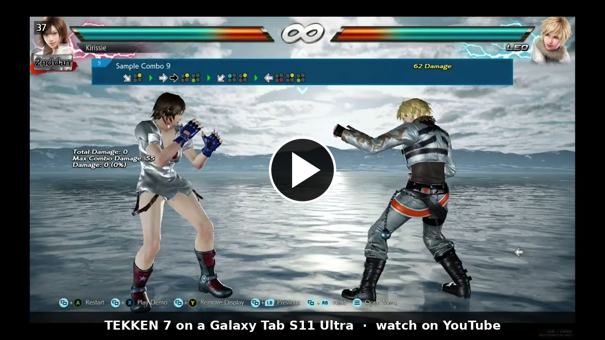
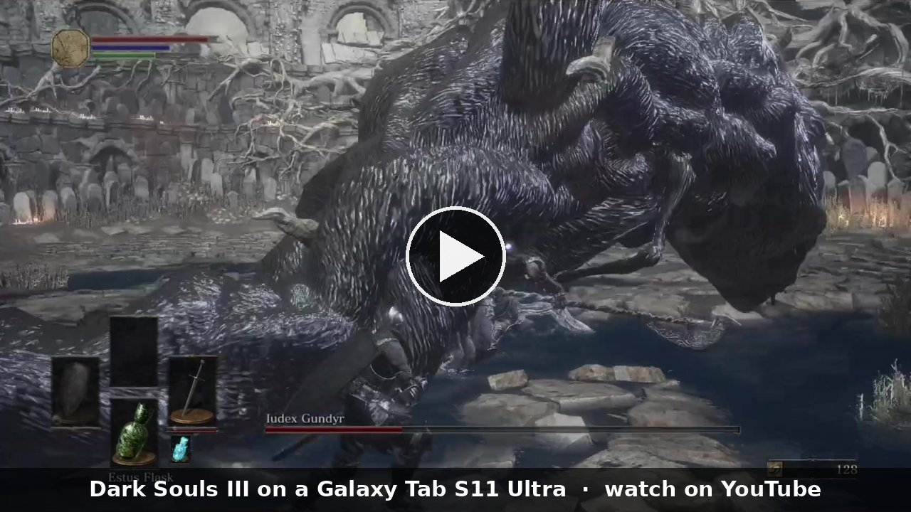
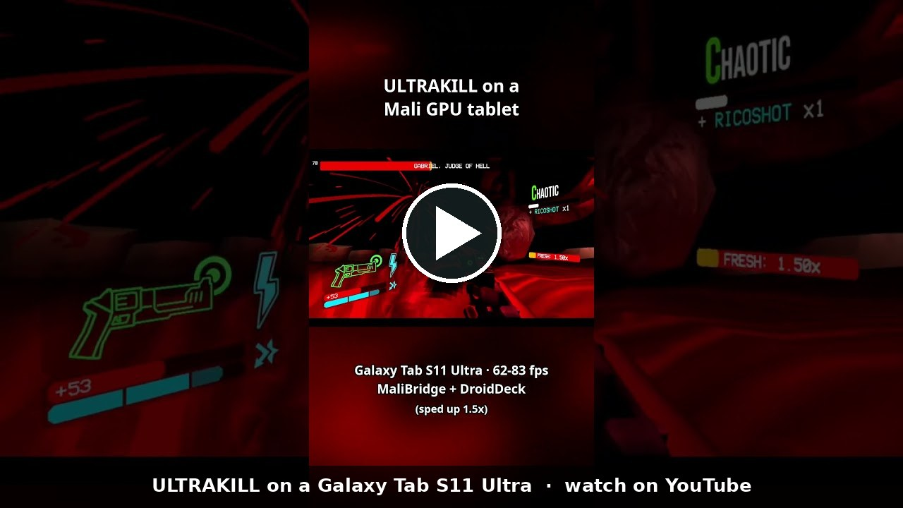
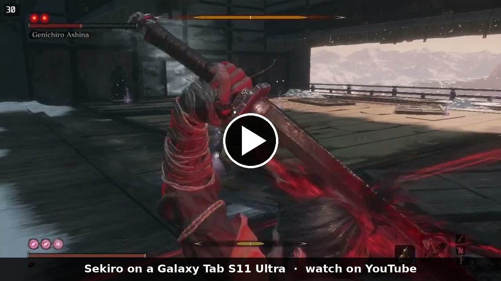
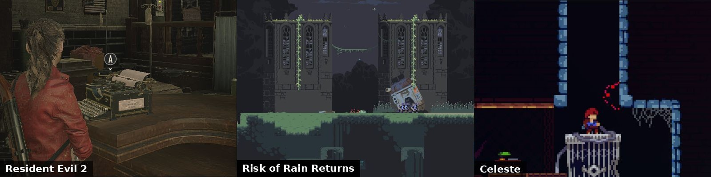

<h1 align="center">MaliBridge（中文说明）</h1>

<a href="README.md">English</a> | 中文

<b>在使用 Mali GPU 的安卓手机和平板上玩 Steam PC 游戏</b> 
联发科天玑、Google Tensor、小米玄戒、较早的三星 Exynos，以及其他 Arm Mali / Immortalis 芯片。 
直接使用设备自带的驱动，不需要另外安装 GPU 驱动。

  
  
  
  
  

  <a href="https://github.com/ASEbrahim/MaliBridge/releases/latest"><b>下载</b></a> ·
  <a href="INSTALL.md"><b>安装指南（英文）</b></a> ·
  <a href="#我的设备能用吗"><b>我的设备能用吗？</b></a> ·
  <a href="#能运行的游戏"><b>能运行的游戏</b></a> ·
  <a href="#最佳设置与性能建议"><b>最佳设置</b></a> ·
  <a href="#获取帮助"><b>获取帮助</b></a> ·
  <a href="#常见问题"><b>常见问题</b></a>

<table align="center">
<tr>
<td align="center" valign="top" width="25%"> 
<i>《铁拳7》，Galaxy Tab S11 Ultra，v0.5.5。</i> 
<a href="https://www.youtube.com/watch?v=xTerCRrXkIU">YouTube</a> · <a href="https://www.youtube.com/shorts/iEbOgO-w8XU">短视频</a></td>
<td align="center" valign="top" width="25%"> 
<i>《黑暗之魂3》。用 v0.5.1 录制，以 2 倍速播放。</i> 
<a href="https://youtu.be/nikeajHpf5s">YouTube</a> · <a href="https://www.bilibili.com/video/BV124HN61EPM">哔哩哔哩</a> · <a href="https://www.reddit.com/r/GalaxyTab/comments/1xea3as/">Reddit 帖子</a></td>
<td align="center" valign="top" width="25%"> 
<i>ULTRAKILL，Gabriel 战。以 1.5 倍速播放。</i> 
<a href="https://youtube.com/shorts/jAMXM8XYq8Y">YouTube</a> · <a href="https://www.reddit.com/r/SBCGaming/comments/1xjkz64/">Reddit 帖子</a></td>
<td align="center" valign="top" width="25%"> 
<i>《只狼》，苇名弦一郎战。用 v0.5.4 录制，正常速度。</i> 
<a href="https://youtu.be/rdEQbt02dK4">YouTube</a> · <a href="https://www.bilibili.com/video/BV1YQn96fECh">哔哩哔哩</a> · <a href="https://www.reddit.com/r/GalaxyTab/comments/1xfn2v6/">Reddit 帖子</a></td>
</tr>
</table>

<a href="https://www.youtube.com/@malibridge">更多视频</a> · <a href="https://space.bilibili.com/3747573858831484">哔哩哔哩</a>

 
<i>在 Galaxy Tab S11 Ultra 上用 v0.5.4 实际游玩的画面。</i>

> [!IMPORTANT]
> 请从本页的 [Releases](https://github.com/ASEbrahim/MaliBridge/releases) 下载 DroidDeck Mali。其他网站上的副本可能是旧版本或被改动过。
> 官方 [DroidDeck](https://github.com/Droid-Deck/DroidDeck) 目前还没有包含 MaliBridge；包含之后，从官方下载也可以。

> 这是英文 README 的中文翻译。如有出入，以[英文版](README.md)为准，那里更新得最快。

**[加入 Discord](https://discord.gg/9xC67qTjDq)**：测试版、帮助和更多额外内容（中国大陆可能无法直接访问）。

**当前版本：v0.5.5**，基于 DroidDeck 0.6.9。更早的版本见 [Releases 页面](https://github.com/ASEbrahim/MaliBridge/releases)。

MaliBridge 运行在 **DroidDeck Mali** 里。DroidDeck Mali 是一个可以配合 DroidDeck 使用的版本（DroidDeck 是在安卓上运行 Steam 客户端和 PC 游戏的应用）。在三星 Galaxy Tab S10+（Mali-G720）和 Galaxy Tab S11 Ultra（Mali-G925）上，我测试过的 36 款游戏达到了可玩或更好的水平，例如《半条命2》约 94 fps、《空洞骑士：丝之歌》、《星露谷物语》、Risk of Rain Returns、《黑暗之魂 重制版》、《盖瑞模组》。玩家还从另外 32 台 Mali 手机、平板和掌机发来了反馈。下面的表格共涉及 93 款不同的游戏，其中 50 款达到可玩或更好。MaliBridge 是免费的。

## 我的设备能用吗？

设备需要使用 Arm Mali GPU（Immortalis 也属于 Mali）；Steam 在部分三星 Xclipse GPU 上也能启动，见表格。不确定自己的芯片？可以在“设置 → 关于手机”（或“关于平板”）里查看处理器，也可以用 CPU-Z 之类的应用查看 GPU。

标签的含义：

- **可用**：Steam 能启动，游戏能运行。有玩家反馈，或者我自己测试过。
- **可用，有说明**：能运行，但有备注里写明的限制。

除两台平板外，其余都来自玩家反馈，我没有亲自测试过这些设备。与下表中某设备 GPU 相同的设备，表现通常也相近；不过各厂商的驱动版本不同，所以依然欢迎反馈。

| GPU | 设备（芯片） | 驱动 | 状态 | 说明 |
|---|---|---|---|---|
| Mali-G57 | Redmi Note 12S（Helio G96） |  | **可用，有说明** | [玩家反馈](https://github.com/ASEbrahim/MaliBridge/discussions/2#discussioncomment-19128201)：Steam 一次就能用；较轻的游戏可以运行（DDNet、YOMI Hustle、Space Menace、Death Road to Canada） |
| Mali-G57 | 小米手机（联发科，G57 MC2） | r54p1 | **可用，有说明** | 《求生之路2》17-19 fps |
| Mali-G57 | 三星 Galaxy F15 | r38p1 | **可用** | Steam 可以打开，玩家已确认 |
| Mali-G68 | 三星 Galaxy A16 5G | r38p1 | **可用** | Steam 可以打开，玩家已确认 |
| Mali-G68 | 三星 Galaxy A54 | r38p1 | **可用，有说明** | Steam 可以打开；菜单较慢 |
| Mali-G76 | 三星 Galaxy S10+ 手机（Exynos 9820） | r38p1 beta | **可用，有说明** | Steam 可以打开，游戏能运行但比较慢 |
| Mali-G77 | Retroid Pocket 4 Pro（天玑 1100） | r32p1 | **可用，有说明** | Steam 和 Big Picture 可以运行；部分画面会闪烁 |
| Mali-G77 | 华为 Nova 7（麒麟 985） |  | **可用，有说明** | 《杀戮尖塔》1 和 2 可以运行；有一款游戏提示 “Direct3D isn't supported” |
| Mali-G78 | 三星 Galaxy S21 | r38p0 | **可用** | 《Muse Dash》约 53 fps |
| Mali-G615 | POCO X6 Pro（天玑 8300-Ultra） |  | **可用，有说明** | [玩家反馈](https://github.com/Droid-Deck/DroidDeck/issues/218#issuecomment-6311114838)：较轻的游戏可以运行（《侠盗猎魔：圣安地列斯》、《火爆狂飙：天堂》约 30 fps）；较重的游戏 12-14 fps |
| Mali-G615 | 天玑 8350 手机 |  | **可用** | [玩家反馈](https://github.com/Droid-Deck/DroidDeck/issues/218#issuecomment-6322050101)：《Rivals of Aether》约 55 fps |
| Mali-G615 | 小米手机（G615 MC2） | r44p1 | **可用** | 《最终幻想 Resonance》约 46 fps |
| Mali-G615 | Infinix 手机（G615 MC6，11.5 GB 内存） | r44p1 | **可用，有说明** | 《铁拳7》9-30 fps；手机的可用内存不足 |
| Mali-G710 | 一加 Ace 2V（天玑 9000） | r32p1 | **可用，有说明** | [玩家反馈](https://github.com/Droid-Deck/DroidDeck/issues/218#issuecomment-6335790759)：《RimWorld》能玩 1-2 小时；《半条命2》能启动。需要手动选择 DXVK 1.10.3 |
| Immortalis-G715 | Pixel 8 / 8 Pro（Tensor G3） | r54 | **可用** | [玩家反馈](https://github.com/Droid-Deck/DroidDeck/issues/218#issuecomment-6306332804)：《茶杯头》60-100 fps，《哈迪斯》30-60 fps，《冤罪杀机》15-25 fps |
| Immortalis-G715 | Pixel 9（Tensor G4） | r54p3 | **可用，有说明** | [玩家反馈](https://github.com/Droid-Deck/DroidDeck/pull/517#issuecomment-6220985381)：Steam 可以启动；游戏尚未确认 |
| Immortalis-G720 | 三星 Galaxy Tab S10+（天玑 9300+） | r44p1 | **可用** | 深入测试 |
| Immortalis-G720 | realme Neo7（天玑 9300+） | r44p1 | **可用** | [玩家反馈](https://github.com/ASEbrahim/MaliBridge/issues/5)：《星露谷物语》约 59 fps，《Balatro》55-72 fps |
| Immortalis-G720 | 小米 14T Pro（天玑 9300+） | r44p1 | **可用，有说明** | [玩家反馈](https://github.com/ASEbrahim/MaliBridge/discussions/2#discussioncomment-19146763)：Steam、手柄和下载都正常；《心灵杀手》低画质 20-50 fps；偶尔有需要重启游戏的画面异常 |
| Mali-G720 | POCO X8 Pro（天玑 8500） | r49p1 | **可用，有说明** | [玩家反馈](https://github.com/ASEbrahim/MaliBridge/issues/9#issuecomment-6328655497)：《印第安纳·琼斯与帝王之墓》约 30 fps；《Hob》会卡顿 |
| Mali-G720 | POCO X7 Pro（天玑 8400-Ultra） | | **可用** | [玩家反馈](https://github.com/ASEbrahim/MaliBridge/issues/23)：较轻的游戏可以运行（Stardew Valley、Rain World、Tukoni: Forest Keepers 等） |
| Immortalis-G925 | 三星 Galaxy Tab S11 Ultra（天玑 9400） | r49p1 | **可用** | 深入测试 |
| Immortalis-G925 | vivo X200（天玑 9400） |  | **可用** | [玩家反馈](https://github.com/Droid-Deck/DroidDeck/issues/218#issuecomment-6314012693)：《欧洲卡车模拟2》约 20 fps，《模拟山羊》约 35 fps |
| Mali-G925 | 小米平板 7S Pro（玄戒 O1） | r49p1 | **可用** | Steam 可以运行 |
| Immortalis-G925 | iQOO Z10 Turbo Plus |  | **可用，有说明** | 《上古卷轴5》约 61 fps；菜单里屏幕手柄没有反应 |
| Mali-G1-Ultra | 小米 17T Pro（天玑 9500） | r54p1 | **可用，有说明** | [玩家反馈](https://github.com/ASEbrahim/MaliBridge/discussions/2#discussioncomment-19149991)：20 多款游戏可以运行（《空洞骑士》《哈迪斯》《死亡细胞》《蔚蓝》）；部分游戏有绿色方块贴图问题 |
| Mali-G1-Ultra | OPPO Find X9 Pro（天玑 9500） | r54p1 | **可用，有说明** | [玩家反馈](https://github.com/Droid-Deck/DroidDeck/issues/218#issuecomment-6312412336)：《Balatro》《杀戮尖塔》；部分游戏有绿色方块贴图问题 |
| Mali-G1-Ultra | Redmi K90 Max（天玑 9500） | r54p1 | **可用，有说明** | [玩家反馈](https://github.com/Droid-Deck/DroidDeck/issues/218#issuecomment-6330586020)：《小小梦魇》和《小小梦魇2》约 10 fps（玩家后来更正）；Reshaping Creatures 5-9 fps |
| Mali-G1-Ultra | vivo X300（天玑 9500） | r54p1 | **可用，有说明** | 《疯狂的麦克斯》稳定 60 fps，《空洞骑士》约 60 fps；Steam 菜单较慢 |
| Mali-G1-Ultra | 三星 Galaxy Tab S12+ | r54p1 | **可用，有说明** | 《蝙蝠侠：阿卡姆疯人院》可以运行；有一段过场动画里灯光会穿墙显示 |
| Mali-G2-Ultra-NX | 小米 18 Fold（玄戒 O3） | r56p0 | **可用** | [玩家反馈](https://github.com/ASEbrahim/MaliBridge/issues/7)：自检 13/13，Steam 可用，《Brotato》约 77 fps |
| Mali-G2-Ultra-NX | 小米平板 9 Pro Max（玄戒 O3） |  | **可用** | [玩家反馈](https://github.com/ASEbrahim/MaliBridge/discussions/2#discussioncomment-19136786)：《人类一败涂地》可玩，《传送门2》1080p 40-50 fps；《泰坦陨落2》暂时无法启动 |
| Xclipse 530 | 三星 Galaxy A55 |  | **可用，有说明** | [玩家反馈](https://github.com/ASEbrahim/MaliBridge/issues/27)：Steam 可以启动；游戏还没有确认 |

设备不在表里，或者有什么不能用？在应用里点 **Send logs to MaliBridge**（发送日志给 MaliBridge），把代码贴到 [Discord](https://discord.gg/9xC67qTjDq)。

更多玩家反馈和测试见 Discord，那里还有测试版、帮助和更多额外内容。

**需要更多反馈：尚未测试的设备。** 这些设备的反馈最有帮助：

| 芯片 | GPU | 设备举例 |
|---|---|---|
| 天玑 9300 / 9300+（其他设备） | Immortalis-G720 MC12 | OPPO Find X7 |
| 天玑 9400 / 9400+（其他设备） | Immortalis-G925 MC12 | OPPO Find X8 |
| 天玑 7300、Helio G99 等 | Mali-G615 / G610 / G57 | 许多中端手机（GPU 较小：只适合较轻的游戏） |
| Exynos 1280 / 2100 | Mali-G68 / G78 | Galaxy A53 |

**非 Mali 芯片：** 骁龙使用 Adreno GPU，请直接使用官方 DroidDeck。三星较新的 Exynos 芯片使用 Xclipse GPU，其中一些手机可以用（表里有 Galaxy A55）。Galaxy S24+（Xclipse 940，[#43](https://github.com/ASEbrahim/MaliBridge/issues/43)）和 A56（Xclipse 540，[#29](https://github.com/ASEbrahim/MaliBridge/issues/29)）在旧版本上无法启动；v0.5.5 为它们做了改动，但我还没有收到确认。后续会支持更多设备。

不在表里的设备依然只算测试：结果取决于 GPU 及其驱动。欢迎发送日志（见[获取帮助](#获取帮助)）。

## 快速开始

1. 先在上面的表格里查一下你的芯片。
2. 从[最新版本](https://github.com/ASEbrahim/MaliBridge/releases/latest)下载 `DroidDeck-MaliBridge-....apk` 并安装。安装后的应用名是 **DroidDeck Mali**，可以和官方 DroidDeck 同时存在。
3. 打开 DroidDeck Mali（**Mali bridge** 默认开启，不确定的话到 **配置**（Setup）页面的“概览”里看一下），启动 **Steam** 会话并登录。
4. 每个游戏都需要在“属性 → 兼容性”里选择 **Proton Experimental ARM64 (Compatible)**。

**需要：** 64 位 Android 8.0 或更新；8 GB 内存以上（较大的游戏建议 12 GB 以上）；游戏之外约 8-10 GB 空闲空间。

**更新：** 应用的 **更新** 页面会提示新版本，点一下就能安装。从旧版本升级时，直接把新的 APK 安装在旧版本上即可，游戏、设置和 Steam 登录都会保留。

[安装指南（英文）](INSTALL.md)里有每一步的详细说明。

**在 [Ko-fi](https://ko-fi.com/asebrahim) 上支持我。**欢迎来 [Discord](https://discord.gg/9xC67qTjDq) 打个招呼，也可以在 [YouTube](https://www.youtube.com/@malibridge) 和 [哔哩哔哩](https://space.bilibili.com/3747573858831484) 上看它的运行效果。

## 能运行的游戏

这些是我在两台平板上玩过的游戏：Galaxy Tab S10+（Mali-G720）和 Galaxy Tab S11 Ultra（Mali-G925），使用[安装指南](INSTALL.md#settings-to-check)里的设置。同一款游戏在 S11 Ultra 上大约快 1.4-2 倍。在其他设备上，表现大致取决于 GPU 的强弱。

**评级**，从差到好：勉强运行、勉强可玩、可玩、很流畅、极佳。我亲自玩过的游戏按实际体验评级，其他的按帧率评级。

| 游戏 | Mali-G720（Tab S10+） | Mali-G925（Tab S11 Ultra） |
|---|---|---|
| Cuphead | **极佳** | **极佳**，Inkwell Isle Two 地图上约 120 fps |
| GRIS | **极佳**，继续游戏后约 105 fps | **极佳**，约 119 fps |
| Phoenix Wright: Ace Attorney Trilogy | **尚未评级**（仅菜单）：标题和菜单约 118 fps | **极佳**，约 118 fps（120 Hz 屏幕刷新率） |
| Doki Doki Literature Club | **极佳**，标题画面 91-92 fps | **极佳**，剧情中 112-114 fps |
| Balatro | **极佳**，一手牌中约 97 fps（v0.5.4.2：约 85-89） | **极佳**，一局游戏中约 112 fps |
| ULTRAKILL | **很流畅**，55-57 fps | **极佳**，0-1 开头 111-116 fps |
| Hades | **极佳** | **极佳**，House of Hades 里 110-128 fps |
| Hollow Knight | **极佳**，87-124 fps。在同一个高负载位置，v0.5.5 与 v0.5.4.2 持平（63.6-65.9 fps 对 61.6-63.9） | **极佳**，110+ fps（玩家反馈） |
| Dead Cells | **极佳** | **极佳**，Prisoners' Quarters 里 110-120 fps |
| A Dance of Fire and Ice | **尚未评级**（仅菜单）：标题场景 45-52 fps | **极佳**，约 106-113 fps；用蓝牙 PS5 手柄没有感觉到输入延迟 |
| Garry's Mod | **很流畅**，gm_construct 地图 49-54 fps（菜单 59） | **极佳**，简单地图中位数 104 fps；Golden City Sandbox 地图中位数 82 fps，最低 34 |
| Half-Life 2 | **极佳**，开场章节 59-74 fps | **极佳**，开场章节 94-103 fps；Water Hazard 约 110 fps |
| Portal | **极佳**，约 63 fps | **极佳**，第一个测试室 85-90 fps（透过传送门看时约 65）；第一个传送门打开时短暂停顿一次 |
| Hollow Knight: Silksong | **极佳**，游戏中稳定 62-66 fps | **极佳**，72-96 fps |
| Celeste | **极佳**，57-59 fps | **极佳**，游戏中 60 fps（上限） |
| The Elder Scrolls V: Skyrim Special Edition | **极佳**，Medium 下约 60 fps（上限）；第三人称流畅，首次加载时有些卡顿 | 未测试 |
| Don't Starve Together | **极佳**，新世界里 60 fps（上限） | **极佳**，60 fps |
| ENDER LILIES | **可玩**，42-44 fps | **极佳**，第一个区域 59-61 fps（上限）；颜色较平淡，和 Stray 一样 |
| Helltaker | **极佳**，游戏中 60 fps（上限） | **极佳**，约 59 fps，运行完美 |
| Stick Fight: The Game | **勉强可玩**，本地大厅稳定 30 fps | **极佳**，59-60 fps（上限） |
| Risk of Rain Returns | **极佳**，游戏中包括 Boss 战 59-60 fps | **极佳**，标题画面和游戏中 59-60 fps |
| Stardew Valley | **极佳**，在农场里游玩时 60 fps（上限） | **极佳**，57-62 fps |
| Inscryption | **极佳**，68-83 fps | **很流畅**，第一张牌桌 55-57 fps，偶尔掉到 20 左右 |
| Dark Souls Remastered | **尚未评级**（仅菜单）：标题和主菜单 60 fps（上限） | **很流畅**，玩了 10 分钟，中位数 53.7 fps，最低 43.9，平板不热时 60 fps（上限）；过场动画正常 |
| Portal 2 | **可玩**，游戏中约 45-50 fps，偶尔掉到 30 左右 | **尚未评级**（仅菜单）：菜单 115 fps |
| Muck | **尚未评级**（仅菜单）：3D 岛屿背景的主菜单 43 fps | **可玩**，岛上 45-48 fps |
| Resident Evil 2 | **可玩**，第一个大厅约 33 fps（DX12），会掉到十几 fps | **可玩**，警察局里约 41 fps（DX11 测试版）。在 v0.5.5 上我自己玩的感觉比之前好很多：约 30 fps，随区域在 15 到 60 fps 之间 |
| R.E.P.O. | **尚未评级**（仅菜单）：预热 50 秒后主菜单约 42 fps | **可玩**，单人模式约 40 fps |
| Tekken 7 | 未测试 | **可玩**，中位数 38 fps，低点约 36，很少低于 30 |
| Sekiro: Shadows Die Twice | 未测试 | **可玩**，游戏中站立约 38 fps |
| Outer Wilds | **勉强运行**，游戏中约 10 fps（标题 73）：平板内存不足（12 GB，大量交换） | **可玩**，起始星球 35-45 fps，太空中约 75-80，Brittle Hollow 二十多 fps，看向黑洞时约 17（GPU 一半空闲）；受 CPU 限制 |
| Dark Souls III | **勉强运行**，站立不动 20-21 fps（v0.5.4.2：约 19），移动时更低，并有短暂卡顿（正在处理） | **勉强可玩**，游戏中站立约 35 fps；移动时短暂卡顿（已知问题） |
| Risk of Rain 2 | **勉强可玩**，半分辨率下，人多、特效多的 Boss 战 18-30 fps（1280x720 下 15-23 fps） | **可玩**，1280x720 下 30-43 fps；拥挤的 Boss 战 20-28 fps（录屏时测量） |
| The Forest | **尚未评级**（仅菜单）：菜单 60 fps；第一次启动在 20 秒后卡住过一次，第二次正常 | **可玩**，四分之一、一半和全分辨率下都是 30-45 fps；受 CPU 限制，所以分辨率没有影响。第一次启动时崩溃过一次，之后没有再出现 |
| Subnautica | **可玩**，细节设为 High 时 20-24 fps | **很流畅**，游戏中 28-40 fps（温控降频时），菜单 81 fps |
| Poppy Playtime (Chapter 1) | **尚未评级**（仅菜单）：第一章主菜单 62-64 fps | **勉强可玩**，工厂大厅 28-32 fps；颜色较平淡，和 Stray 一样 |
| Lethal Company | **可玩**，43-45 fps | **勉强可玩**，飞船上约 25 fps，有掉帧（比 S10+ 低，正在复查） |
| The Witcher 3 (DX12) | **勉强运行**，加载时 GPU 长时间卡住 | **勉强可玩**，中位数约 29 fps（23-37）；有一次在过场动画里卡死（正在处理） |
| Bright Memory: Infinite | **勉强运行**，DirectX 11 下站立不动约 22 fps，移动时更低；DirectX 12 模式无法运行 | 未测试 |
| Stray | **勉强运行**，开场 17 fps（受 CPU 限制） | **可玩**，游戏中约 20 fps；颜色较平淡（见已知问题） |
| ASTRONEER | **尚未评级**（仅菜单）：3D 菜单 27-29 fps | **勉强可玩**，画面正常（没有白屏）；全低画质约 20 fps，Ultra 约 17；受 CPU 限制；颜色较平淡 |
| Elden Ring（DX12，离线） | 未测试 | **勉强运行**，进入世界后一直是 12 fps（正在处理） |
| Deep Rock Galactic | **勉强可玩**，较慢 | **已知问题**：标题画面正常，但进入 Space Rig 后游戏可能会卡住。正在处理 |

仅供参考：GameNative（另一款应用，用于许多 Mali 设备）的公开玩家汇总把 Outer Wilds、The Forest 和 ASTRONEER 在 Mali 上评得较低；这不是同条件对比。游戏的成绩、设置和测试版会在 [Discord](https://discord.gg/9xC67qTjDq) 上分享。

这些数字是怎么测的

G925 上的 Celeste、Balatro、Dark Souls III、Sekiro 和 Resident Evil 2，以及 Half-Life 2 的 Water Hazard 数据，是 2026 年 10 月用 v0.5.4 测量的：进入游戏后站立不动，每款 60 秒，用游戏自己的帧数统计。G925 上的 Dark Souls Remastered 和 Garry's Mod 是在安全模式下亲手玩的。G925 的其他数据来自 v0.4，只有 Subnautica 的菜单、Half-Life 2 和 Stray 是用 v0.5 测量的。从 Poppy Playtime 到 Outer Wilds 这几款，是 2026 年 10 月用 v0.5 的版本在 G925 上亲手玩的（fps 读自启动器的帧数计数器）。G925 上的 Hades、ULTRAKILL、Portal、Cuphead、Dead Cells、ENDER LILIES、Inscryption 和 Doki Doki Literature Club，以及 G720 上的 Helltaker、Stardew Valley 和 Don't Starve Together，是 2026 年 10 月用 v0.5.4.1 进入实际游戏场景后测量的：每款 75-90 秒，按屏幕的帧时间统计。G925 上的 Lethal Company、G720 上的 Resident Evil 2（DX12），以及 G925 上的 Elden Ring（DX12，离线），是之后补测的（Elden Ring 用的是 10 月 27 日的版本）。G925 上的 Tekken 7 和 The Witcher 3（DX12），以及 G720 上的 Balatro、Portal、Hollow Knight、Dark Souls III 和 Bright Memory: Infinite，是用 v0.5.5 测量的。Resident Evil 2 在 v0.5.5 上的说明来自我自己的游玩，不是测量数据。Risk of Rain Returns 以前会在开场视频卡住，现在在两台平板上都修好了。

**玩家反馈。** 其他玩家在自己设备上跑起来的游戏。fps 是他们自己读到的数字。按 GPU 分组，性能强的在前：点开一组即可看到其中的游戏。

<b>Mali-G1-Ultra（天玑 9500）：小米 17T Pro、Redmi K90 Max 等</b>（30 款游戏）

| 游戏 | 设备（GPU） | 结果 |
|---|---|---|
| Hades | 小米 17T Pro（天玑 9500） | [DirectX 模式 100-120 fps，Vulkan 模式 45-55；有绿色方块贴图问题（正在处理）](https://github.com/ASEbrahim/MaliBridge/discussions/2#discussioncomment-19149991) |
| Cuphead | 小米 17T Pro（天玑 9500） | [80+ fps；有绿色方块贴图问题（正在处理）](https://github.com/ASEbrahim/MaliBridge/discussions/2#discussioncomment-19149991) |
| Dead Cells | 小米 17T Pro（天玑 9500） | [80+ fps，画面没有问题](https://github.com/ASEbrahim/MaliBridge/discussions/2#discussioncomment-19149991) |
| Hades II | 小米 17T Pro（天玑 9500） | [80-110 fps；有绿色方块贴图问题（正在处理）](https://github.com/ASEbrahim/MaliBridge/discussions/2#discussioncomment-19149991) |
| 20 Minutes Till Dawn | 小米 17T Pro（天玑 9500） | [60+ fps，敌人多时掉帧](https://github.com/ASEbrahim/MaliBridge/discussions/2#discussioncomment-19149991) |
| Celeste | 小米 17T Pro（天玑 9500） | [稳定 60 fps](https://github.com/ASEbrahim/MaliBridge/discussions/2#discussioncomment-19149991) |
| Hollow Knight | 小米 17T Pro（天玑 9500） | [60-80 fps；有绿色方块贴图问题（正在处理）](https://github.com/ASEbrahim/MaliBridge/discussions/2#discussioncomment-19149991) |
| Hollow Knight: Silksong | 小米 17T Pro（天玑 9500） | [游戏中 60-75 fps，菜单 100；有绿色方块贴图问题（正在处理）](https://github.com/ASEbrahim/MaliBridge/discussions/2#discussioncomment-19149991) |
| Little Nightmares | Redmi K90 Max（天玑 9500） | [约 10 fps（玩家起初说 60，后来更正）](https://github.com/Droid-Deck/DroidDeck/issues/218#issuecomment-6330586020) |
| Little Nightmares II | Redmi K90 Max（天玑 9500） | [约 10 fps（玩家起初说 60，后来更正）](https://github.com/Droid-Deck/DroidDeck/issues/218#issuecomment-6330586020) |
| Mad Max | vivo X300（天玑 9500） | 稳定 60 fps |
| Slay the Spire | 天玑 9500 手机（G1-Ultra） | [60-70 fps](https://github.com/Droid-Deck/DroidDeck/issues/218#issuecomment-6312412336) |
| Balatro | 天玑 9500 手机（G1-Ultra） | [约 55 fps](https://github.com/Droid-Deck/DroidDeck/issues/218#issuecomment-6312412336) |
| Megabonk | 小米 17T Pro（天玑 9500） | [开始 50-60 fps，敌人变多后下降](https://github.com/ASEbrahim/MaliBridge/discussions/2#discussioncomment-19149991) |
| Portal | 小米 17T Pro（天玑 9500） | [50-115 fps，有波动](https://github.com/ASEbrahim/MaliBridge/discussions/2#discussioncomment-19149991) |
| Chants of Sennaar | 小米 17T Pro（天玑 9500） | [40+ fps](https://github.com/ASEbrahim/MaliBridge/discussions/2#discussioncomment-19149991) |
| Constance | 小米 17T Pro（天玑 9500） | [稳定 40 fps；有绿色方块贴图问题（正在处理）](https://github.com/ASEbrahim/MaliBridge/discussions/2#discussioncomment-19149991) |
| ENDER LILIES | 小米 17T Pro（天玑 9500） | [40-60 fps，攻击时偶有波动](https://github.com/ASEbrahim/MaliBridge/discussions/2#discussioncomment-19149991) |
| Have a Nice Death | 小米 17T Pro（天玑 9500） | [30-50 fps](https://github.com/ASEbrahim/MaliBridge/discussions/2#discussioncomment-19149991) |
| Lobotomy Corporation | 天玑 9500 手机（G1-Ultra） | [约 30 fps；部分背景有绿色像素](https://github.com/Droid-Deck/DroidDeck/issues/218#issuecomment-6312412336) |
| Firewatch | 小米 17T Pro（天玑 9500） | [20-30 fps](https://github.com/ASEbrahim/MaliBridge/discussions/2#discussioncomment-19149991) |
| Metro 2033 Redux | 小米 17T Pro（天玑 9500） | 20-30 fps；加载需要几分钟 |
| Ori and the Will of the Wisps | 小米 17T Pro（天玑 9500） | [最低预设 20-30 fps](https://github.com/ASEbrahim/MaliBridge/discussions/2#discussioncomment-19149991) |
| Death's Door | 小米 17T Pro（天玑 9500） | [15-20 fps；有绿色方块贴图问题（正在处理）](https://github.com/ASEbrahim/MaliBridge/discussions/2#discussioncomment-19149991) |
| Library of Ruina | 天玑 9500 手机（G1-Ultra） | [15-35 fps；部分背景有绿色像素](https://github.com/Droid-Deck/DroidDeck/issues/218#issuecomment-6312412336) |
| Cult of the Lamb | 小米 17T Pro（天玑 9500） | [能启动，最低预设 800x600 约 10 fps](https://github.com/ASEbrahim/MaliBridge/discussions/2#discussioncomment-19149991) |
| Cairn | 小米 17T Pro（天玑 9500） | [最低画质 8-12 fps](https://github.com/ASEbrahim/MaliBridge/discussions/2#discussioncomment-19149991) |
| Sable | 小米 17T Pro（天玑 9500） | [游戏中 8-24 fps，菜单 60](https://github.com/ASEbrahim/MaliBridge/discussions/2#discussioncomment-19149991) |
| Reshaping Creatures | Redmi K90 Max（天玑 9500） | [能启动；5-9 fps](https://github.com/Droid-Deck/DroidDeck/issues/218#issuecomment-6307692808) |
| Batman: Arkham Asylum GOTY | Galaxy Tab S12+（G1-Ultra） | 可以运行；小丑坐在椅子上的过场动画里灯光会穿墙显示（正在处理） |

在小米 17T Pro 上还不能运行：Blasphemous 和 Dishonored 停在加载画面，SOMA 在第一次加载结束时关闭。

<b>Mali-G2-Ultra（玄戒 O3）：小米 18 Fold、小米平板 9 Pro Max</b>（4 款游戏）

| 游戏 | 设备（GPU） | 结果 |
|---|---|---|
| Brotato | 小米 18 Fold（玄戒 O3） | [约 77 fps](https://github.com/ASEbrahim/MaliBridge/issues/7) |
| Portal 2 | 小米平板 9 Pro Max（玄戒 O3） | [1080p 40-50 fps](https://github.com/ASEbrahim/MaliBridge/discussions/2#discussioncomment-19137389) |
| Human Fall Flat | 小米平板 9 Pro Max（玄戒 O3） | [可以运行](https://github.com/ASEbrahim/MaliBridge/discussions/2#discussioncomment-19136786) |
| Titanfall 2 | 小米 M367FC（玄戒 O3，12 GB） | [**勉强能运行**：v0.5.2 上 57-83 fps，但 3-5 分钟后安卓因内存不足将其关闭；v0.5.4.1 占用内存更少，但在 v0.5.4.x 上无法启动。v0.5.5 会运行 EA 应用的安装步骤，应该可以启动；尚未确认](https://github.com/ASEbrahim/MaliBridge/issues/18) |

<b>Immortalis-G925（天玑 9400）：vivo X200、iQOO Z10 Turbo Plus</b>（4 款游戏）

| 游戏 | 设备（GPU） | 结果 |
|---|---|---|
| Skyrim | iQOO Z10 Turbo Plus（G925） | 约 61 fps |
| Goat Simulator | vivo X200（G925） | 约 35 fps |
| Euro Truck Simulator 2 | vivo X200（G925） | [游戏中约 20 fps（中画质，1600x720），菜单流畅](https://github.com/Droid-Deck/DroidDeck/issues/218#issuecomment-6314012693) |
| CarX Drift Racing Online | vivo X200（G925） | [最低画质游戏中 9-20 fps，有卡顿](https://github.com/Droid-Deck/DroidDeck/issues/218#issuecomment-6314012693) |

<b>Immortalis-G720（天玑 9300）：realme Neo7、小米 14T Pro</b>（3 款游戏）

| 游戏 | 设备（GPU） | 结果 |
|---|---|---|
| Stardew Valley | realme Neo7（G720） | [约 59 fps](https://github.com/ASEbrahim/MaliBridge/issues/5) |
| Balatro | realme Neo7（G720） | [55-72 fps；之前缺失的文字已修复](https://github.com/ASEbrahim/MaliBridge/issues/5) |
| Alan Wake | 小米 14T Pro（G720） | [低画质 20-50 fps](https://github.com/ASEbrahim/MaliBridge/discussions/2#discussioncomment-19146763) |

<b>Mali-G720 MC7/MC8（天玑 8400/8500）：POCO X7 Pro、POCO X8 Pro</b>（7 款游戏）

| 游戏 | 设备（GPU） | 结果 |
|---|---|---|
| Indiana Jones and the Emperor's Tomb | POCO X8 Pro（G720 MC8） | [使用 Stability FEX 预设时游戏中约 30 fps；Performance 预设会因 “invalid camera matrix” 错误停止](https://github.com/ASEbrahim/MaliBridge/issues/9#issuecomment-6328655497) |
| Good Company | POCO X7 Pro (G720 MC7) | [可以运行；需要用 PC 键盘操作](https://github.com/ASEbrahim/MaliBridge/issues/23) |
| Hob | POCO X8 Pro（G720 MC8） | [可玩，有些卡顿，正在处理](https://github.com/ASEbrahim/MaliBridge/issues/14) |
| Japanese Rural Life Adventure | POCO X7 Pro (G720 MC7) | [可以玩](https://github.com/ASEbrahim/MaliBridge/issues/23) |
| Rain World | POCO X7 Pro (G720 MC7) | [可以玩](https://github.com/ASEbrahim/MaliBridge/issues/23) |
| Stardew Valley | POCO X7 Pro (G720 MC7) | [可以玩](https://github.com/ASEbrahim/MaliBridge/issues/23) |
| Tukoni: Forest Keepers | POCO X7 Pro (G720 MC7) | [可以玩](https://github.com/ASEbrahim/MaliBridge/issues/23) |

<b>Mali-G715（Tensor G3）：Pixel 8、Pixel 8 Pro</b>（5 款游戏）

| 游戏 | 设备（GPU） | 结果 |
|---|---|---|
| Cuphead | Pixel 8（G715） | [60-100 fps](https://github.com/Droid-Deck/DroidDeck/issues/218#issuecomment-6306332804) |
| Hades | Pixel 8（G715） | [30-60 fps](https://github.com/Droid-Deck/DroidDeck/issues/218#issuecomment-6306332804) |
| The Elder Scrolls V: Skyrim | Pixel 8 Pro（G715） | [低画质 17-20 fps，战斗时掉帧](https://github.com/ASEbrahim/MaliBridge/discussions/2#discussioncomment-19098757) |
| Balatro | Pixel 8 Pro（G715） | [35-50 fps](https://github.com/ASEbrahim/MaliBridge/discussions/2#discussioncomment-19076725) |
| Dishonored | Pixel 8 Pro（G715） | [菜单 30 fps，序章 15-25，移动时掉帧](https://github.com/ASEbrahim/MaliBridge/discussions/2#discussioncomment-19088953) |

<b>Mali-G710（天玑 9000）：一加 Ace 2V</b>（2 款游戏）

| 游戏 | 设备（GPU） | 结果 |
|---|---|---|
| Half-Life 2 | 一加，天玑 9000（G710） | [手动选择 DXVK 1.10.3 后可以启动](https://github.com/Droid-Deck/DroidDeck/issues/218#issuecomment-6307774367) |
| RimWorld | 一加 Ace 2V（G710） | [用 DXVK 1.10.3 玩了 1-2 小时](https://github.com/Droid-Deck/DroidDeck/issues/218#issuecomment-6335790759) |

<b>Mali-G78（Exynos 2100）：Galaxy S21</b>（1 款游戏）

| 游戏 | 设备（GPU） | 结果 |
|---|---|---|
| Muse Dash | Galaxy S21（G78） | 约 53 fps |

<b>Mali-G77（麒麟 985）：华为 Nova 7</b>（1 款游戏）

| 游戏 | 设备（GPU） | 结果 |
|---|---|---|
| Slay the Spire | 华为 Nova 7（G77） | 可以运行 |

<b>Mali-G615（天玑 8300/8350）：POCO X6 Pro 等</b>（7 款游戏）

| 游戏 | 设备（GPU） | 结果 |
|---|---|---|
| Rivals of Aether | 天玑 8350 手机（G615） | [约 55 fps](https://github.com/Droid-Deck/DroidDeck/issues/218#issuecomment-6322050101) |
| Final Fantasy Resonance | 小米手机（G615 MC2） | 约 46 fps |
| GTA San Andreas | POCO X6 Pro（G615） | [约 30 fps](https://github.com/Droid-Deck/DroidDeck/issues/218#issuecomment-6311114838) |
| Prince of Persia: Warrior Within | POCO X6 Pro（G615） | [约 30 fps](https://github.com/Droid-Deck/DroidDeck/issues/218#issuecomment-6311114838) |
| Burnout Paradise | POCO X6 Pro（G615） | [20-30 fps](https://github.com/Droid-Deck/DroidDeck/issues/218#issuecomment-6311114838) |
| Tekken 7 | Infinix 手机（G615 MC6） | 9-30 fps；手机可用内存很少 |
| Palia | POCO X6 Pro（G615） | [4-10 fps](https://github.com/Droid-Deck/DroidDeck/issues/218#issuecomment-6311114838) |

<b>Mali-G57（Helio G96）：Redmi Note 12S 和一款小米手机</b>（7 款游戏）

| 游戏 | 设备（GPU） | 结果 |
|---|---|---|
| Space Menace | Redmi Note 12S（G57） | [60 fps，偶有小卡顿](https://github.com/ASEbrahim/MaliBridge/discussions/2#discussioncomment-19166394) |
| Death Road to Canada | Redmi Note 12S（G57） | [30-60 fps](https://github.com/ASEbrahim/MaliBridge/discussions/2#discussioncomment-19128201) |
| Zombie Blocks 2 | Redmi Note 12S（G57） | [低画质约 30 fps](https://github.com/ASEbrahim/MaliBridge/discussions/2#discussioncomment-19128201) |
| Left 4 Dead 2 | 小米手机（G57 MC2） | 800x450 下 17-19 fps |
| Left 4 Dead | Redmi Note 12S（G57） | [15-40 fps](https://github.com/ASEbrahim/MaliBridge/discussions/2#discussioncomment-19128201) |
| YOMI Hustle | Redmi Note 12S（G57） | [10-60 fps，带模组](https://github.com/ASEbrahim/MaliBridge/discussions/2#discussioncomment-19166394) |
| DDNet | Redmi Note 12S（G57） | [OpenGL 模式可用，目前只能离线](https://github.com/ASEbrahim/MaliBridge/discussions/2#discussioncomment-19166394) |

## 最佳设置与性能建议

- **Proton：** 每个游戏都选 **Proton Experimental ARM64 (Compatible)**。列表中 Valve 官方的 “Proton (ARM64)” 和 “Steam Linux Runtime” 在 DroidDeck 里无法启动。同时有 Linux 版本的游戏（《传送门2》《半条命2》等）需要手动设置。
- **先用安全模式（默认）。** 它的兼容性最好。**性能模式**（Safe mode 关闭）在 Mali bridge 按钮下面；在我的平板上它只快 0-2%，在较弱的 GPU（Mali-G57、G68、G610）上，我看过的日志里没有提升。等游戏已经能正常运行后再试，如果出问题，先切回安全模式再反馈。
- **DXVK: automatic**（默认）会在 GPU 太旧、跑不了 Proton 自带 DXVK 的手机上换用较旧的 DXVK。
- **Steam menus: automatic**（默认）可以避免较旧的 Mali GPU 上 Steam 菜单黑屏。如果 Steam 还是黑屏，改成 **Steam menus: software**，游戏仍然使用 GPU。
- **MaliBridge 会自动设置的游戏：** 《饥荒联机版》（Don't Starve Together）、较旧手机上的《半条命2》和《环世界》、Indiana Jones and the Emperor's Tomb，以及 Stray、SOMA 和两款 Amnesia。这些游戏不需要设置启动选项。

Safe mode、DXVK 和 Steam menus 都在 **配置**（Setup）页面的 **Mali bridge** 按钮下面。[安装指南（英文）](INSTALL.md#how-demanding-each-game-is)按负载高低给游戏分了组。

两种模式在我的平板上的帧率对比（fps 中位数，每个游戏每种模式跑一次，接 USB 供电，温控状态 0-1）。游戏是按顺序跑的，没有交替，所以几个百分点的差别属于正常误差。

| 游戏（场景） | G720 安全 | G720 性能 | G925 安全 | G925 性能 |
|---|---|---|---|---|
| Half-Life 2（火车场景） | 74.1 | 75.9 | 93.7 | 93.7 |
| Subnautica（菜单） | 62.0 | 62.3 | 81.3 | 81.5 |
| Stray（标题） | 17.1 | 15.8 | 58.4 | 58.0 |
| Stardew Valley（标题，60 fps 上限） | 60.0 | 60.0 | 60.0 | 60.0 |
| Risk of Rain 2（标题） | 35.6 | 35.8 | 56.8 | 没有完整的一次（见已知问题） |
| Skyrim Special Edition（主菜单，60 fps 上限） | 60.7 | 60.7 | 未测试 | 未测试 |

**建议**

- **游戏卡的话，降低分辨率。** 可以用游戏自己的分辨率或渲染比例，也可以用 DroidDeck 的 Steam 分辨率设置（默认 720p）。当 GPU 是瓶颈时（较弱的芯片上大多数游戏都是）这很有用；对受 CPU 限制的游戏（The Forest、ASTRONEER、Outer Wilds）没有作用。
- **设置帧率上限。** 在 Steam 的性能设置里选 30 或 60（或者能整除屏幕刷新率的数字）。稳定的 30 比忽高忽低的 40 感觉更好，机身也更凉。
- **给设备降温。** 手机发热后会自己降频；我在两台平板上都看到过玩一阵后帧率下降。取下保护壳，不要边快充边玩，长时间游玩时把帧率上限调低一些。
- **先关掉其他应用。** 内存不足时安卓会关闭游戏，较重的游戏需要更多内存：较轻的游戏 8 GB 够用，大型游戏需要 12 GB 以上。可用内存很少的手机，同一款游戏会慢很多。
- **第一次启动会比较慢。** 第一次打开 Steam，以及第一次启动每个游戏时，都会编译着色器，画面会卡顿。Steam 显示 “Processing Vulkan shaders” 时，等它处理完。之后会流畅很多。
- **留够存储空间。** 游戏之外需要 8-10 GB，再加上每个游戏本身的大小，以及随游玩增长的几百 MB 缓存。
- **如果 Steam 一直要求登录，或者停在加载画面，** 先登录一次，然后把 Steam 切到离线模式（Steam 菜单里的 Go Offline）。已安装的游戏仍然可以启动；下载和更新需要联网。
- **如果游戏关闭或画面不对，** 先停止会话，然后点 **Send logs to MaliBridge**（见下）。每次会话只启动一次游戏，这样日志里只会有一次尝试。
- **游戏跑得不好，就到 [Discord](https://discord.gg/9xC67qTjDq) 问一下**；其他玩家会在那里分享自己的设置。

### 查看帧数

- **Steam 性能叠加层**（Steam 会话中）：按 **⋯** 键打开 Steam 快捷菜单，进入 **Performance**（⚡ 页），调整
  **Performance Overlay Level**：1 只显示帧数，4 显示全部信息（CPU、内存、电池、帧时间曲线）。只有打开时才运行。
  所有设备都能用；隐藏温度传感器的三星平板也能用。手机不让应用读取的数值（常见的是 CPU 温度或 GPU 功耗）显示为 0。
- **性能 HUD**（DroidDeck Mali 自带）：侧边菜单 → **显示** → **性能 HUD**。显示帧数，以及电量、电池温度、功耗（瓦）和
  安卓的温控状态，数据来自安卓本身，所以所有设备都能用。功耗只在会报告电池电流的手机上显示，温控状态需要安卓 10 或更新版本。
  Steam 会话中默认关闭，因为已有 Steam 的叠加层。

## 获取帮助

> [!TIP]
> 最快的帮助在 [Discord](https://discord.gg/9xC67qTjDq)（中国大陆可能无法直接访问）：其他玩家和我都会在那里回答。

**Send logs to MaliBridge。**

1. 让游戏关闭，然后在侧边菜单点 **停止**（Stop）。
2. 点 **Send logs to MaliBridge**（在 **配置 > Diagnostics**、会话结束画面或侧边菜单里）。它会给你一个短代码，例如 `ML-7F3K`。
3. 把代码贴到 Discord 或 [GitHub Issues](https://github.com/ASEbrahim/MaliBridge/issues) 里。

上传的内容（同意前应用会这样说明）：你的设备型号、你运行过的游戏名称，以及这次会话的日志。账户名、密码和令牌会先被移除。日志保存 90 天，只有开发者能看到。

**也可以自己分享日志：** 在 **配置 > Diagnostics** 里点 **最新会话日志** 旁边的 **分享日志**，把生成的 zip 附到 issue 或 Discord 帖子里。

**新建 issue：** 打开 [Issues](https://github.com/ASEbrahim/MaliBridge/issues)，写上手机型号、MaliBridge 版本、你做了什么、发生了什么（比如“Steam 一直没出现”或“游戏一启动就关闭”），以及日志代码或 zip。用中文或英文写都可以，机器翻译也没问题。

**最有帮助的反馈：** 表格里没有的 Mali 设备、黑屏，以及一启动就关闭的游戏。每次会话只启动一次游戏，这样日志里只会有一次尝试。

[安装指南（英文）](INSTALL.md#if-something-goes-wrong)里有更详细的说明。

## 已知问题

- Galaxy A16、A54、F15、Tab S9 FE、Tab S10 Lite 和 Anbernic RG556 上的 **OpenGL 游戏**还没有测试。
- 一些边走边加载贴图的游戏（《黑暗之魂3》、Hob）在**移动时会短暂卡顿**。
- 在**部分 vivo 和 iQOO 手机**上，Steam 的菜单可能只有约 15 fps，打开菜单时会白屏闪一下。v0.5.5 为此做了改动，但还没有在手机上确认。如果你有这些手机，日志会有帮助。
- **Mali-G925 上的《巫师3》（DX12）**约 29 fps，但有一次在过场动画里卡死。正在处理。
- **Mali-G720 上的《Bright Memory: Infinite》**在 DirectX 11 下勉强运行，DirectX 12 模式无法运行。
- **Mali-G925 上的 Deep Rock Galactic** 进入 Space Rig 后可能会卡住。正在处理。
- **Mali-G925 上的 Stray 和 ENDER LILIES** 颜色较平淡，没有游戏自己的调色效果（Poppy Playtime 和 ASTRONEER 也是）。正在处理。
- **Stray 加 `-dx12` 启动**时，在 G925 上大约 60 秒后关闭。默认的 DX11 没有问题。
- **Risk of Rain 2**：在 G925 上有一次性能模式启动时，标题加载约 2 分钟没有画面，之后恢复正常。之后没有再出现。
- **Mali-G925 上的 Steam 窗口**可能有些慢。游戏不受影响。
- 天玑 9500 手机（Mali-G1-Ultra）的部分游戏有**绿色方块贴图问题**。正在处理。
- **Just Cause 2** 无法启动：Steam 的防拷贝检查在 DroidDeck 里耗时太长。
- **《生化危机2》**菜单上可能出现 “Failed to send play data to RE NET”。按 OK 即可，游戏正常运行，只影响 Capcom 的在线游玩统计。
- **《黑暗之魂3》在较慢的设备上**可能提示 “Frame rate unsuitable for online play” 并回到标题画面。这是游戏自己的规则（低于约 20 fps）：在这些设备上请离线游玩。
- **Outer Wilds、ASTRONEER 和 The Forest** 在 G925 上受 CPU 限制，降低分辨率或画质帮助不大。

## 接下来

- 修复移动时的短暂卡顿（《黑暗之魂3》、Hob）。
- 更多性能优化。
- 第一次进入新区域时更流畅。
- 受 CPU 限制的游戏（The Forest、ASTRONEER、Outer Wilds）以及 Just Cause 2。
- DirectX 12：《巫师3》过场动画卡死、DX12 下的 Stray、《艾尔登法环》、Bright Memory。
- 更多设备：来自我没测试过的 Mali GPU 的反馈，是最快的途径。

## 常见问题

**需要多少存储空间？**
游戏之外约 **8-10 GB**：Linux 运行环境、Steam 客户端和 Proton。每个游戏另外需要它本身的大小，再加几百 MB。

**可以保留官方 DroidDeck 吗？**
可以。DroidDeck Mali 是独立的应用，有自己的 Steam 登录、游戏和设置。

**带反作弊的网络游戏能玩吗？**
我没有测试过。很多反作弊系统在 Proton 下根本无法运行，所以基本无法游玩。

**和 PanVK 一样吗？**
不一样。PanVK 会替换手机的驱动，MaliBridge 保留手机自带的驱动。它们是不同的项目。

**能在 GameNative、Winlator 等应用里用吗？**
不能。MaliBridge 内置在 Releases 页面的 DroidDeck Mali 里。

**免费吗？是官方的吗？**
免费。它不是官方 DroidDeck 的一部分：DroidDeck Mali 是一个可以配合 DroidDeck 使用的版本，由一个单独的项目制作。

更多问题见[英文安装指南的 FAQ](INSTALL.md#faq)。所有版本：[发布历史](https://github.com/ASEbrahim/MaliBridge/releases)。

## 交流与支持

所有测试、发送日志和支持 MaliBridge 的朋友都在 [致谢名单](CREDITS.zh-CN.md) 里。谢谢大家！

- Discord：[加入服务器](https://discord.gg/9xC67qTjDq)，获取帮助和新消息（中国大陆可能无法直接访问）
- 在 [Ko-fi](https://ko-fi.com/asebrahim) 上支持我
- 视频：[哔哩哔哩](https://space.bilibili.com/3747573858831484) · [YouTube](https://www.youtube.com/@malibridge)
- 反馈问题和设备报告：[GitHub Issues](https://github.com/ASEbrahim/MaliBridge/issues)

## 致谢与许可

MaliBridge 采用 GPL-3.0-or-later 许可，并在第 7 节附加了两条条款（见 [NOTICE](NOTICE)）：发布 MaliBridge 或基于它的作品时，需要保留明显的 “MaliBridge by ASEbrahim” 署名和指向本页的链接；修改过的版本不能自称 MaliBridge。详见 [LICENSE](LICENSE)。源文件都带有 SPDX 许可声明头和版权行。

名称、DroidDeck 与致谢

**致谢：** 感谢 Mondyro 找到天玑 9500 的贴图问题（[#24](https://github.com/ASEbrahim/MaliBridge/issues/24)）。

**关于名称。** 欢迎在许可范围内 fork，但 “MaliBridge” 这个名字只指本项目；请给你的 fork 起一个自己的名字。

DroidDeck Mali 基于 [DroidDeck](https://github.com/Droid-Deck/DroidDeck)（GPL-3.0），但不是官方 DroidDeck 的一部分。第三方代码和致谢名单见[英文 README](README.md#credits-and-licence)。

